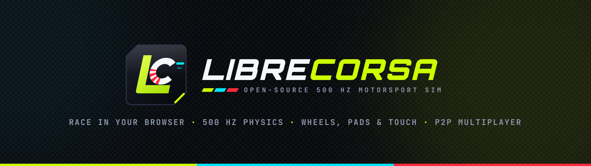
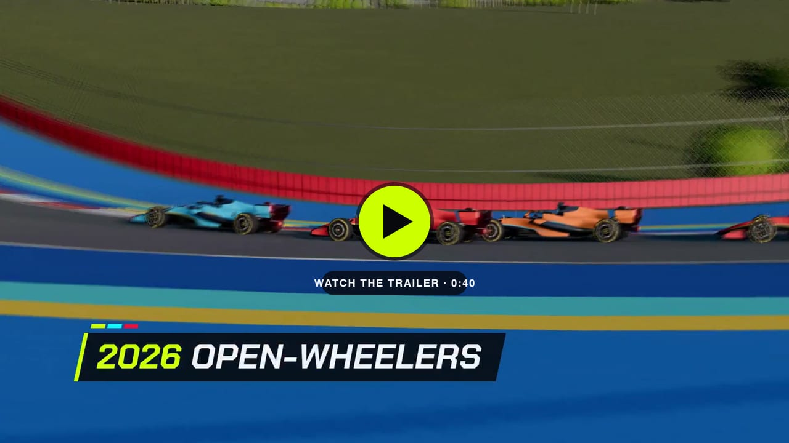
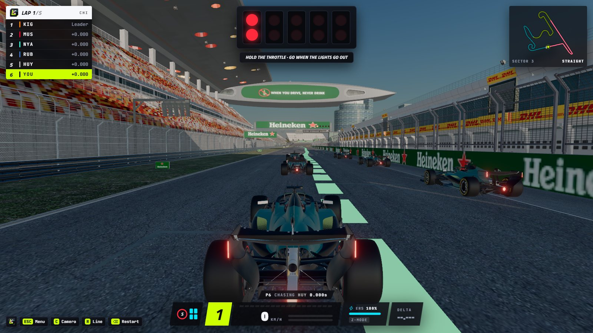
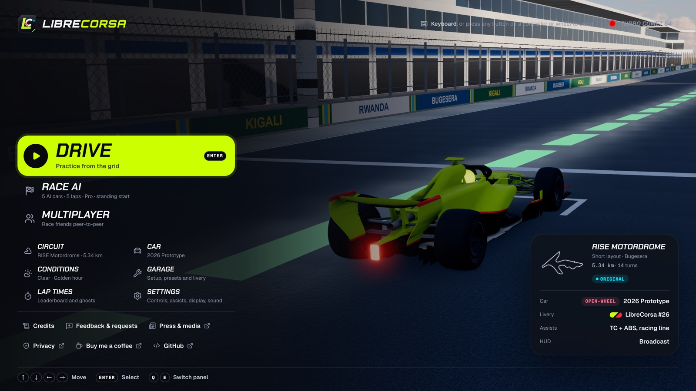
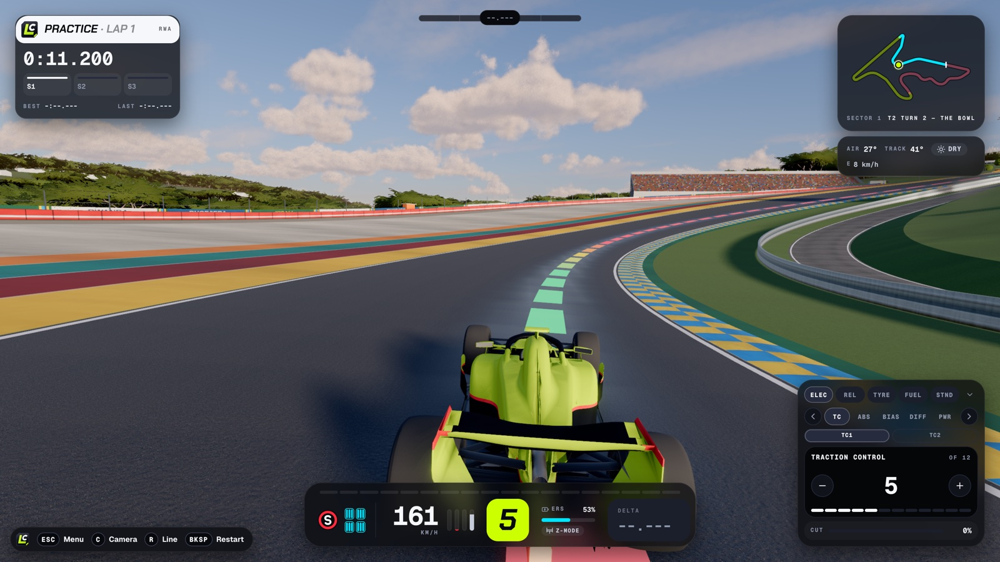
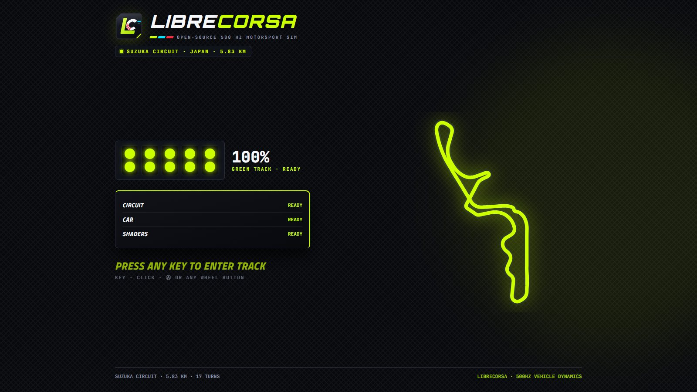

<div align="center">



<p>
  <a href="https://librecorsa.org/"><b>▶&nbsp; Play in your browser</b></a>
  &nbsp;·&nbsp;
  <a href="#features">Features</a>
  &nbsp;·&nbsp;
  <a href="#controls">Controls</a>
  &nbsp;·&nbsp;
  <a href="#development">Development</a>
  &nbsp;·&nbsp;
  <a href="CREDITS.md">Credits</a>
</p>

<p>
  <a href="https://github.com/KhazP/librecorsa/actions/workflows/deploy-pages.yml"></a>
  <a href="LICENSE"></a>
  
  
  
  <a href="https://buymeacoffee.com/alpyalayg"></a>
</p>

</div>

<p align="center">
  <a href="https://librecorsa.org/media/librecorsa-trailer.mp4"></a>
</p>

**LibreCorsa** is an open-source racing simulator that runs entirely in the browser. It has 500 Hz vehicle dynamics, a thermal tyre model, 2026-regulation open-wheelers, GT3 cars, a prototype and a road car. There are fourteen circuits and two hill climbs, AI races, ghosts and replays, and peer-to-peer multiplayer. It works with a keyboard, gamepad, touch screen or a force-feedback wheel. Nothing to install, and no server: it ships as a static site.

<p align="center">
  
</p>

<table>
  <tr>
    <td width="33%"></td>
    <td width="33%"></td>
    <td width="33%"></td>
  </tr>
  <tr>
    <td align="center"><sub>Title menu and garage</sub></td>
    <td align="center"><sub>RISE Motordrome</sub></td>
    <td align="center"><sub>Every circuit draws itself while it loads</sub></td>
  </tr>
</table>

> LibreCorsa is an independent fan project. It is not affiliated with Formula 1, the FIA, any team or any circuit.

---

## Features

### Physics
- **500 Hz fixed-step integration** (4 × 2 kHz sub-steps), with each wheel riding the real track surface. The default 2026 Prototype's chassis is planar (speed, side-slip and yaw on the local road plane) plus sprung heave, pitch and roll. The 2026 Rigid-Body, the GT3s, the MTRacing 496R and the Suzuki Liana run on a 6-DOF rigid body that carries the spinning wheels' gyroscopic coupling. Their tyres feel the road over the whole contact patch: five ground samples per wheel (centre, both ends, both tread edges) fold into one height and slope, so a seam or a kerb's step edge is rolled over rather than hit at a point, and the road carries a fine ISO 8608 texture (about 0.5 mm RMS) for them to roll over.
- **Tyres**: a Pacejka-style slip curve with combined slip on a friction ellipse, load sensitivity, carcass relaxation, a load-dependent rolling radius and a pneumatic trail set by the contact patch's length. On the 6-DOF cars the cornering stiffness saturates with load, so the peak slip angle grows under load. Grip follows the inner, middle and outer tread temperatures: a 9-node thermal model (surface, bulk and carcass per band) on the 2026 Prototype, a tread surface over a carcass per band on the 6-DOF cars. Ideal-gas pressure sets carcass stiffness, and the tyres wear. Soft, medium and hard slicks, plus intermediates and full wets that clear water up to a depth and aquaplane past it.
- **Chassis**: double-wishbone suspension built from its hardpoints, with springs, dampers, bump stops, anti-roll bars and heave elements. On the 6-DOF cars the solver poses each upright for camber, Ackermann and bump steer, and the tyre forces reach the body through the links: roll-centre jacking, anti-dive, anti-squat and anti-lift, and the full load transfer. The 2026 Prototype takes its roll centres from the hardpoints. The race cars have a preload / power / coast limited-slip differential (the 2026 Rigid-Body's entry, mid and exit maps blend with the pedals and the steering), the Rigid-Body and the GT3s have compliant halfshafts, and every car has thermal brakes whose pad friction changes with temperature.
- **Steering**: on the 6-DOF cars the rack torque is the front tyres' moment about the kingpin axes: braking and drive force at the scrub radius, cornering force at the caster and pneumatic trail, the steered wheels' weight jacking, and the wheels' gyroscopic torque. A parked tyre twists against the road instead of turning freely, and the road texture reaches the rim only through the tyre forces. The 2026 Rigid-Body and the GT3s have hydraulic power steering (the GT3's fades out with speed) and give up a little steering angle under cornering force. The 2026 Prototype sums the same kinds of moment with fixed gains.
- **Aero**: ride-height-sensitive wings and floor, altitude-corrected air density, and dirty air behind other cars. 2026 active aero switches between Z-mode (cornering) and X-mode (straights).
- **Surfaces**: one data table for road, kerb, sausage kerb, run-off, pit lane, grass and gravel, with dry and wet friction, rolling resistance, a bump ripple you feel through the wheel, vibration and whether it counts for track limits. A circuit can override it in its track data. Kerbs rise to a 32 mm crown with a 2 mm ripple.
- **Weather and time of day**: clear, overcast, light rain, heavy rain, drying and dynamic weather. The water film builds and drains, and the cars dry the racing line first. Six times of day, and the clock can run at up to 60×. On Medium and High graphics a physically based sky with volumetric clouds follows the weather.
- **Evolving track**: the racing line rubbers in as you drive.
- **Assists**: traction control on the friction circle, ABS, and a slip-angle-limited steering assist for keyboards and gamepads (S-curve key ramp, self-aligning, slide catch) with pedal slip help for the keys. Each can be tuned, and all but the keyboard's steering assist switched off.
- **Realism levels**: Casual (no tyre wear or fuel use, milder rain), Standard and Full.

### Cars
| Car | Model | Notes |
| :-- | :-- | :-- |
| **2026 Prototype** (default) | Planar chassis + heave / pitch / roll, 4 sprung corners | 1.6 L V6 turbo + 350 kW MGU-K, 4 MJ battery, manual override boost, Z/X-mode aero |
| **2026 Rigid-Body** | 6-DOF rigid body on the track colliders | The same 350 kW / 4 MJ hybrid; turbo boost that builds with exhaust energy while the MGU-K fills the lag; driver-opened X-mode flaps in every DRS zone, and Overtake Mode earned within 1 s at the detection point; live telemetry channels |
| **Mercedes-AMG GT3 Evo** | 6-DOF rigid body | 6.2 L NA V8, 6-speed sequential, multi-stage ABS / TC, its own braking-point model. The BMW M4 GT3 Evo drives on its physics |
| **MTRacing 496R** | 6-DOF rigid body | 2025 prototype: 4.0 L NA V8, rear-wheel drive, 6-speed paddle shift, heave springs, splitter / diffuser / rear-wing aero, TC, three slicks. 20 liveries, a live wheel screen and shift lights. Model, sound and physics from munyuturbo's mod of this car, used with permission |
| **Suzuki Liana 1.6** | 6-DOF rigid body | 2002 road car: 1.6 L four, front-wheel drive through an open differential, 5-speed manual, ABS and TC, one street tyre. Physics from alekabul's mod of this car, used with permission |

Each car has its own cockpit, steering wheel and shift lights, plus a multi-layer sound bank (engine, turbo, transmission, shifts, backfires, limiter, tyre skid, TC cut). Interior and exterior sounds switch with the camera.

### Circuits
| Circuit | Country | Length |
| :-- | :-- | --: |
| **RISE Motordrome** (default; short / Grand Prix lap) | Rwanda | 5.34 / 5.89 km |
| Chang International Circuit | Thailand | 4.57 km |
| Okayama International Circuit (GP / Piper / Formula Drift) | Japan | 3.70 / 1.97 / 1.97 km |
| Red Bull Ring — Spielberg (GP / South / Inner skill course) | Austria | 4.32 / 2.34 / 0.94 km |
| Automotodrom Grobnik | Croatia | 4.17 km |
| Motorsport Arena Oschersleben | Germany | 3.69 km |
| Circuit de Monaco | Monaco | 3.30 km |
| Istanbul Park | Turkey | 5.32 km |
| Dunsfold Aerodrome | United Kingdom | 2.88 km |
| Barbagallo Raceway | Australia | 2.39 km |
| Virginia International Raceway (Full / North / South / Grand East / Grand West / Patriot, both ways) | United States | 5.25 / 3.66 / 2.61 / 6.45 / 6.63 / 1.57 km |
| Sachsenring (GP / short course) | Germany | 3.66 / 1.52 km |
| Norisring | Germany | 2.16 km |
| Circuit de la Sarthe, 1982 | France | 13.65 km |

### Hill climbs
| Hill climb | Country | Run | Climb |
| :-- | :-- | --: | --: |
| Goodwood (Festival of Speed) | United Kingdom | 1.89 km | 94 m |
| Borgloh (Osnabrück hill climb) | Germany | 2.02 km | 76 m |

RISE Motordrome is my reading of the circuit planned beside Lake Kidogo at Bugesera, about 1,400 m above sea level: traced on the designers' own aerial renders and built in Blender on the site's real ground by `scripts/rwanda-official/`. Two anticlockwise laps share one model: the short lap (5.34 km, 14 corners, the default) and the Grand Prix lap (5.89 km, 17 corners, 191 m climbed a lap). Chang, Okayama, Spielberg (Red Bull Ring), Grobnik, Oschersleben and Monaco are Assetto Corsa circuits by **Mitja Bonca** (used with permission), converted by `scripts/tracks/port_ac_track.py` with their 3D/2D trees, dynamic tyre grooves, skidmarks, starting lights and trackside semaphores, AI fast/pit lanes, kerbs, surface tables, section names, DRS zones, and TV cameras. Barbagallo and VIR are by **dazzyb2k3**, and Sachsenring, Norisring, Le Mans 1982 and the two hill climbs by **gunnar333**, all used with permission and converted the same way. A hill climb is one timed run from the start line to the finish, one car at a time, so it has no AI or online races. Every circuit is meshopt-compressed (`npm run compress-tracks`) while keeping hidden physics meshes bit-exact, and has a lap-time-optimal racing line for each car class (the hill climbs and Le Mans keep a geometric one for now). Open the sim with `?colliders=1` to see the physics surfaces drawn over the circuit.

### Racing
- **Race the AI**: a 5-car field with a standing start behind the lights, traffic and side-by-side racing, and after the flag a cool-down lap, the top three on the podium and a results screen with places gained and your last races. The AI level runs from Rookie to Alien and can be changed from the pause menu. Each car class has a tuning file in [`public/ai`](public/ai), with per-circuit and per-section overrides. The AI learns braking points and apex speeds corner by corner. In the rain it fits intermediates or full wets and plans its corner speeds and braking on the wet grip.
- **Split gaps**: the gap to the car ahead and behind at every sector split.
- **Practice tools**: lap and sector timing, a live delta, a ghost of your best lap (saved in your browser, and it can be exported and imported), a 90-second instant replay with free cameras, and a lap summary.
- **Multiplayer**: private rooms, peer-to-peer over WebRTC. Host a room and send the link, or join with a friend's 6-character code; a manual offer/answer copy-paste works with no server at all, and browser tabs on the same machine can race each other. On librecorsa.org the site's own room server pairs the players and hands out relay servers for networks that block a direct link; without it the public PeerJS broker pairs them. Other players' cars are sent 60 times a second and predicted to the present from their newest packet, timed by the fastest trip measured, so you touch a car where you see it; contact with them is soft and switches off while their packets are stale. A car that goes quiet keeps going for a second, turns see-through, and disappears until it is heard from again. Everyone in a room needs the same version of the game.
- **Weekly challenge**: one circuit and car for everyone each week, with the assists and realism fixed and a dry track. It has its own lap board. Each round opens with the Suzuki Liana at Dunsfold, then every circuit comes up with a different car than the round before.
- **Open races**: under Multiplayer, a race on the week's circuit and car (RISE Motordrome in the Dunsfold week, which is a time trial only) starts every 20 minutes for whoever has joined, with the week's fastest on pole (alone, you race the AI). Cars are ghosts on the opening lap, and after it a car that is stopped, going the wrong way, rejoining the track or ramming another passes through the others, as does a car that has taken the flag.
- **Race results**: the race server (or a room's host) sends one official result for everyone. Open races are kept, and the Open races card shows the week's top five by wins and podiums and your own record. A result counts for your name once you've claimed it with a lap on the board.
- **Online leaderboard**: one board per circuit and car. Every driver appears once, with their fastest lap and the assists, realism and surface it was driven with, and the board can be narrowed to no-assist, full-realism or wet laps. New personal bests are posted by themselves, and any lap on the board can be raced as a ghost. Without an online side, the board lists your own best laps.
- **Usage counter**: when you stop driving, the game sends the circuit, the car, the mode and the minutes driven, and the site only adds them to daily totals by country. No player id, no cookie, no address is kept, and nothing ties one drive to the next. What the site keeps is set out on the [privacy page](https://librecorsa.org/privacy).

The online side (rooms, boards, scheduled races) is a Cloudflare Worker in [`cloudflare/`](cloudflare/README.md). It is optional: a copy of the game without it still has peer-to-peer rooms and local lap times.
- **Cameras**: cockpit eye-point with live mirrors and the steering-wheel display, a broadcast T-cam, chase, and trackside TV cameras that pan, zoom and cut between corners.

### Hardware
- **Wheels**: steering, pedals and buttons through the browser for any wheel. Force feedback straight from the browser over WebHID for bases that use the standard HID PID protocol, or through a local bridge on Windows. See [Wheels and force feedback](#wheels-and-force-feedback) for what has been tested.
- **Gamepads**: Xbox and PlayStation, with rumble and trigger rumble.
- **Touch**: on-screen pedals and steering, or tilt to steer.
- **Telemetry out**: 60 Hz UDP JSON through the bridge, for dashboards and motion rigs. The bridge relays it with or without a wheel, on Windows, macOS or Linux; the packet format is `TelemetryOutPacket` in `src/lib/input/telemetry-out.ts`.
- **Setup wizard**: picks your device and tunes steering, pedals and force feedback on first launch.
- **VR (work in progress)**: WebXR headsets (Quest Browser, or Chrome with SteamVR / OpenXR), from the Display panel. Expect rough edges.

### Wheels and force feedback

Steering, pedals and buttons come through the browser's Gamepad API, so any wheel that Windows, macOS or Linux sees as a game controller can drive. Force feedback has two paths:

- **In the browser (WebHID, Chrome or Edge)**: click **Connect wheel** in the wheel setup. It drives bases that expose the standard USB HID PID force-feedback reports and the Logitech G25, G27, G29 and Driving Force GT with nothing to install, and the Logitech G920 and G923 for Xbox once Logitech G HUB has switched them out of Xbox mode. It also tries the Thrustmaster T300RS, T-GT II, T248, TX, TS-XW and TS-PC (untested), once a driver has switched the wheel out of its start-up mode. On a base that offers them, friction and inertia run on the wheel itself; the G27 and G29 get rev lights. Experimental.
- **Local bridge (Windows)**: a small helper that talks DirectInput to any force-feedback wheel. It needs a copy of this repository and Node.js: run `npm install` once, then `npm run ffb` and keep it open. The game finds it on `127.0.0.1:18500`. For the hosted site, allow its origin when you start the bridge (origin only, no path):
  - PowerShell: `$env:FFB_ALLOW_ORIGIN="https://librecorsa.org"; npm run ffb`
  - cmd: `set "FFB_ALLOW_ORIGIN=https://librecorsa.org" && npm run ffb`

Only what the maintainer has driven is marked tested. Everything else is what the code should do, not a promise:

| Wheel | Browser (WebHID) | Bridge (Windows) | Status |
| :-- | :-- | :-- | :-- |
| MOZA R9 V2 + KS | Connects and steers | Expected | **Tested: connects. Force feedback not yet confirmed** |
| Other MOZA bases, Simucube 2, VRS, OpenFFBoard, other HID PID bases | Expected | Expected | Untested |
| Simagic, Cammus, Asetek, Fanatec DD (PC mode), Thrustmaster DD | Unknown: without HID PID force feedback the page switches to the bridge | Expected | Untested |
| Logitech G25, G27, G29, Driving Force GT | Expected: the classic Logitech commands, rev LEDs on the G27 and G29 | Expected | Untested |
| Logitech G920, G923 for Xbox | Expected: HID++ force feedback as Linux hid-logitech-hidpp sends it, in PC mode (G HUB switches it) | Expected | Untested |
| Logitech G923 for PlayStation, G PRO | No: no mainline Linux driver to follow for their force feedback | Expected | Untested |
| Thrustmaster T300RS, T-GT II, T248, TX, TS-XW, TS-PC | Unknown: the commands of the Linux driver hid-tmff2, once a driver has switched the wheel out of its start-up mode (Thrustmaster's on Windows, hid-tminit on Linux). If it has not, or Windows refuses the commands, the page switches to the bridge | Expected | Untested |
| Thrustmaster T150, TMX, T500RS | No: a different command set (T150, TMX), or not covered by hid-tmff2 (T500RS) | Expected | Untested |
| Fanatec CSL Elite | Unknown: without HID PID force feedback the page switches to the bridge | Expected | Untested |

Drove one of these, or a wheel that isn't listed? A [wheel report](https://github.com/KhazP/librecorsa/issues/new?template=wheel-report.yml) moves it into the table.

---

## Physics validation

The physics is checked against data, not just tuned by feel, and the evidence is generated from the simulator's own code so anyone can reproduce it ([full page](docs/physics/README.md), `npm run physics:report`).

- **The GT3 against a real car.** The Mercedes-AMG GT3 runs the same manoeuvres as reference GT3 Evo MoTeC logs: sustained cornering, braking and full-throttle g by speed, gearing and the understeer gradient. Every point sits within −13 % to +17 % of the logs, and `npm run verify` fails the build if one leaves its tolerance.
- **Tyre curves for the 2026 Prototype, the 2026 Rigid-Body and the GT3**: force against slip angle at four loads, grip against load, temperature and pressure.
- **Honest gaps**: the 2026 Prototype corners 14 % below the cornering-limit table in its reference data at 86 km/h, where it runs out of front grip, and 4–17 % above it from 144 km/h up. The page says so.
- **Frame-rate independence**: physics runs in fixed 2 ms steps (500 Hz, four 2 kHz substeps), so the same three-second launch ends within 0.3 km/h and 0.2 m at 30, 60, 144 or 240 fps.

<p align="center">
  
  
</p>

---

## Controls

| Input | Action |
| :-- | :-- |
| `W` / `↑` · `S` / `↓` | Throttle · brake (ramped like a pedal) |
| `A` / `D` or `←` / `→` | Steer (speed-sensitive on keyboard) |
| `E` / `Q` | Upshift / downshift |
| `Space` / `Shift` / `B` | Manual override boost (MGU-K) |
| `X` | Active aero (Z-mode / X-mode) or DRS |
| `C` | Cycle cameras |
| `R` | Racing and braking line |
| `P` | Racing-line autopilot |
| `V` | 1:1 mouse steering |
| `M` | Mute |
| `Backspace` | Restart from a flying lap |
| `L` | Restart the lap from a flying start (outside a race) |
| `Esc` | Pause menu |
| **Gamepad** | Left stick steer · `RT` / `R2` throttle · `LT` / `L2` brake · `A` / `✕` boost |

Every binding can be changed under **Controls**.

---

## Development

```bash
npm install
npm run dev              # dev server at http://localhost:3000
npm run build            # static export into ./out
```

| Script | What it does |
| :-- | :-- |
| `npm run typecheck` | `tsc --noEmit` over the whole project |
| `npm run verify` | Every `scripts/verify-*.ts` suite (physics, 2026 Rigid-Body, GT3, input, lap tools, race session, realism, weather, AI tuning, telemetry out, WebHID FFB) |
| `npm run verify:laps` | Slow: player-style laps for every car and assist preset at full pace |
| `npm run physics:report` | Regenerate the [physics validation page](docs/physics/README.md): tyre curves, the GT3 against MoTeC logs, frame-rate checks |
| `npm run race:headless` | A full-physics AI race without rendering, faster than real time, with a results table. `-- --track suzuka --car amg-gt3 --weather heavy_rain --sweep skill` |
| `npm run compress-tracks` | Meshopt-compress the circuit GLBs and check the physics meshes are unchanged |
| `npm run ffb` | Local force-feedback (Windows) and telemetry bridge. Without a wheel, or with `-- --telemetry-only`, it relays telemetry only |
| `npm run upload-hosted -- <paths>` | Upload hosted-only cars or circuits to R2 (see [What's in the repository](#whats-in-the-repository)) |
| `npm run car-thumbs [-- <car id> ...]` | Render the car browser's picture of each car beside its files (`public/cars/<id>/thumb.webp`; upload a hosted car's with `upload-hosted`) |
| `npm run home-outlines` | Redraw the home page's circuit maps (`src/lib/home/circuit-outlines.json`) after adding a circuit or changing its line |

The tech is **Next.js 16** (static export), **React 19**, **Three.js** (WebGL2, AgX tone mapping, PBR), the **Web Audio API**, **WebRTC**, **WebHID** and **Tailwind CSS 4**.

### What's in the repository
A clone carries **RISE Motordrome** and the **2026 prototype car** (both versions: its body and sound in `public/cars/f12026/`), so `npm run dev` gives you a working game with those. Every other car and circuit is hosted on librecorsa.org only and is gitignored: the files sit in the `librecorsa-assets` R2 bucket, and `cloudflare/worker.js` serves them at the same paths. A clone lists only what it has (`src/lib/hosted-content.ts`); the deploy sets `NEXT_PUBLIC_HOSTED_CONTENT=1` to list everything, and you can set it in `.env.local` if you have the hosted files in `public/`. The verify suites skip checks that need files a clone doesn't have.

To add your own car, see **[Porting a car](docs/PORTING-CARS.md)**. To publish a hosted car or circuit, upload its folder with `npm run upload-hosted -- public/cars/<id>` (car models go up compressed), then push to `main` so the edge cache picks it up.

### Deployment
Every push to `main` runs typecheck and the verify suites, then builds `./out` and deploys it to Cloudflare at [librecorsa.org](https://librecorsa.org/) (`.github/workflows/deploy-pages.yml`, `wrangler.jsonc`). The old GitHub Pages address, `khazp.github.io/librecorsa/`, serves a redirect page that keeps old links working and carries a returning player's saved settings, setups and ghost laps over (`cloudflare/old-site-redirect.html`, `cloudflare/worker.js`). Cloudflare's asset store takes files up to 25 MiB, so CI moves anything bigger into the `librecorsa-assets` R2 bucket; the hosted-only cars and circuits live there too, and the Worker serves both at the same URL. Hosting costs nothing.

---

## License & credits

- **Code** is under the [MIT License](LICENSE).
- **3D models and audio** are for non-commercial, personal and educational use. Each one keeps its own license. This repository carries only RISE Motordrome and the 2026 prototype's model and sound; the rest are served on librecorsa.org for playing there.
- **Cars**: the 2026 car model is by **DeX** ([CC BY 4.0](https://skfb.ly/pKNCK)), the Mercedes-AMG GT3 Evo by **Vecarz** ([CC BY-NC-SA 4.0](https://sketchfab.com/3d-models/mercedes-amg-gt3-wwwvecarzcom-6a3f7e3455064721b74b7f0b66427a07)), and the BMW M4 GT3 Evo by **Ddiaz Design** ([CC BY-NC-SA 4.0](https://sketchfab.com/3d-models/2025-bmw-m4-gt3-evo-g82-113f83dd87064697a5ec2511d280b9d5)).
- **Circuits**: Chang International Circuit, Okayama International Circuit, Spielberg (Red Bull Ring), Automotodrom Grobnik, Oschersleben and Circuit de Monaco are by **Mitja Bonca** (used with permission).
- **RISE Motordrome**: the circuit, its buildings, stands and props are the project's own, built by `scripts/rwanda-official/` and licensed under [CC BY-NC-SA 4.0](public/tracks/rwanda_official/LICENSE.md): port it or build on it with credit, non-commercially, under the same licence. Its trees are the acacia by **evolveduk** and the shrub by **Natural_Disbuster (lemedesign)**, both CC BY 4.0.
- **Rights holders**: if you made a model, texture, sound or other asset used here and want it credited, corrected or removed, open a [**rights / takedown request**](https://github.com/KhazP/librecorsa/issues/new?template=takedown-request.yml) — it will be fixed or removed from the live site, usually within 7 days.

> [!CAUTION]
> **No Official Cryptocurrency:** LibreCorsa has no official token or cryptocurrency, and is not related to any third-party actors trying to profit off of this repo. Any coin on crypto sites using the LibreCorsa name, logo, or repository link is unauthorized and unaffiliated with the developer.

Full attribution and links are in [CREDITS.md](CREDITS.md).
