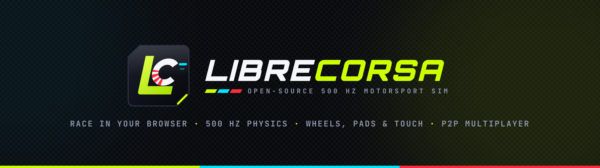
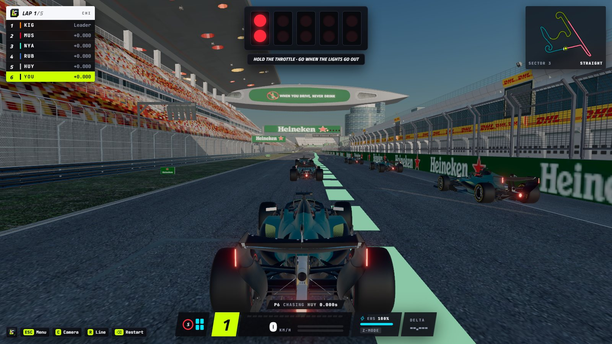
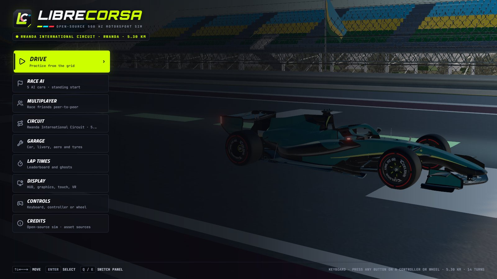
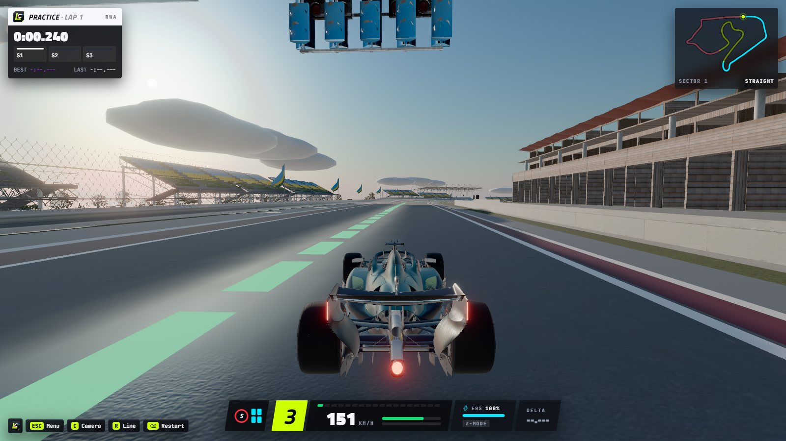
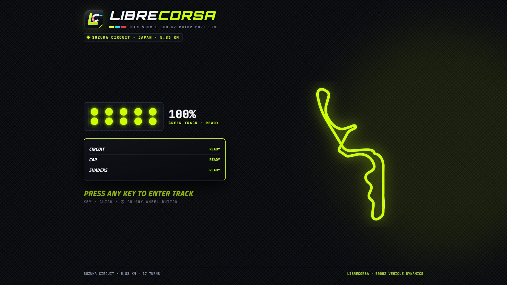

<div align="center">



<p>
  <a href="https://khazp.github.io/rwanda-f1-2026-sim/"><b>▶&nbsp; Play in your browser</b></a>
  &nbsp;·&nbsp;
  <a href="#features">Features</a>
  &nbsp;·&nbsp;
  <a href="#controls">Controls</a>
  &nbsp;·&nbsp;
  <a href="#development">Development</a>
  &nbsp;·&nbsp;
  <a href="CREDITS.md">Credits</a>
</p>

<p>
  <a href="https://github.com/KhazP/rwanda-f1-2026-sim/actions/workflows/deploy-pages.yml"></a>
  <a href="LICENSE"></a>
  
  
  
</p>

</div>

**LibreCorsa** is an open-source racing simulator that runs entirely in the browser. It has rigid-body vehicle dynamics at 500 Hz, a thermal tyre model, 2026-regulation open-wheelers and a GT3 car. There are four circuits, AI races, ghosts and replays, and peer-to-peer multiplayer. It works with a keyboard, gamepad, touch screen or a force-feedback wheel. Nothing to install, and no server: it ships as a static site.

<p align="center">
  
</p>

<table>
  <tr>
    <td width="33%"></td>
    <td width="33%"></td>
    <td width="33%"></td>
  </tr>
  <tr>
    <td align="center"><sub>Title menu and garage</sub></td>
    <td align="center"><sub>Rwanda International Circuit</sub></td>
    <td align="center"><sub>Every circuit draws itself while it loads</sub></td>
  </tr>
</table>

> LibreCorsa is an independent fan project. It is not affiliated with Formula 1, the FIA, any team or any circuit.

---

## Features

### Physics
- **500 Hz fixed-step integration** (4 × 2 kHz sub-steps): a 3D rigid body with each wheel riding the real track surface.
- **Tyres**: a Pacejka-style slip curve with combined slip, load sensitivity, carcass relaxation and a load-dependent rolling radius. A 9-node thermal model (inner/middle/outer × surface/bulk/carcass) sets the grip window, ideal-gas pressure sets carcass stiffness, and the tyres wear. Soft, medium and hard compounds.
- **Chassis**: double-wishbone kinematics with roll centres from the hardpoints, springs, dampers, bump stops, anti-roll bars and heave elements. There's a preload / power / coast limited-slip differential and thermal brakes whose pad friction changes with temperature.
- **Aero**: ride-height-sensitive wings and floor, altitude-corrected air density, and dirty air behind other cars. 2026 active aero switches between Z-mode (cornering) and X-mode (straights).
- **Evolving track**: the racing line rubbers in as you drive.
- **Assists**: traction control on the friction circle, ABS, and a slip-angle-limited steering assist for gamepads. Each one can be switched off.

### Cars
| Car | Model | Notes |
| :-- | :-- | :-- |
| **2026 open-wheeler** (default) | 500 Hz 4-wheel model | 1.6 L V6 turbo + 350 kW MGU-K, 4 MJ battery, manual override boost, Z/X-mode aero |
| **f12026-car** | 6-DOF rigid body on the track colliders | Load-sensitive normalized-slip tyres, driver-operated DRS with detection points, live telemetry channels |
| **Mercedes-AMG GT3** | 6-DOF rigid body | 6.2 L NA V8, 6-speed sequential, multi-stage ABS / TC, its own braking-point model |

Each car has its own cockpit, steering wheel and shift lights, plus a multi-layer sound bank (engine, turbo, transmission, shifts, backfires, limiter, tyre skid, TC cut). Interior and exterior sounds switch with the camera.

### Circuits
| Circuit | Country | Length |
| :-- | :-- | --: |
| **Rwanda International Circuit** (fictional, default) | Rwanda | 5.30 km |
| Suzuka Circuit | Japan | 5.83 km |
| Shanghai International Circuit | China | 5.40 km |
| Mobility Resort Motegi | Japan | 4.78 km |

The Rwanda circuit was built in Blender for this project: 14 corners, 52 m of elevation, 1,400 m above sea level. The others are CC BY 4.0 Sketchfab scans, converted by `scripts/tracks/build_track.py`. It traces the centreline, rescales each scan to the official lap length and detects kerbs, run-off, gravel, barriers, corners and DRS zones. Then `npm run compress-tracks` meshopt-compresses the meshes, and the hidden physics meshes stay bit-exact. Every circuit has a lap-time-optimal racing line for each car class. Open the sim with `?colliders=1` to see the physics surfaces drawn over the scan.

### Racing
- **Race the AI**: a 5-car field with a standing start behind the lights, traffic and side-by-side racing, and a results screen.
- **Practice tools**: lap and sector timing, a live delta, a ghost of your best lap (saved in your browser, and it can be exported and imported), a 90-second instant replay with free cameras, and a lap summary.
- **Multiplayer**: peer-to-peer over WebRTC. Use a 6-character room code, or a manual offer/answer copy-paste with no signalling server at all. Browser tabs on the same machine pair up automatically. Remote cars are interpolated at display rate.
- **Online leaderboard**: laps and their ghosts go to a free Supabase project ([`scripts/leaderboard-supabase`](scripts/leaderboard-supabase)). Without one configured, the board lists your own best laps. A Cloudflare Worker version is in [`scripts/leaderboard-worker`](scripts/leaderboard-worker).
- **Cameras**: cockpit eye-point with live mirrors and the steering-wheel display, a broadcast T-cam, chase, and trackside TV cameras that pan, zoom and cut between corners.

### Hardware
- **Wheels**: force feedback straight from the browser over WebHID, for direct-drive bases that use the standard HID PID protocol (Simagic, Moza, Simucube, VRS, OpenFFBoard and similar). Wheels that WebHID can't drive, Logitech included, use the local bridge (`npm run ffb`, Windows).
- **Gamepads**: Xbox and PlayStation, with rumble and trigger rumble.
- **Touch**: on-screen pedals and steering, or tilt to steer.
- **Telemetry out**: 60 Hz UDP JSON through the bridge, for dashboards and motion rigs.
- **Setup wizard**: picks your device and tunes steering, pedals and force feedback on first launch.

---

## Controls

| Input | Action |
| :-- | :-- |
| `W` / `↑` · `S` / `↓` | Throttle · brake (ramped like a pedal) |
| `A` / `D` or `←` / `→` | Steer (speed-sensitive on keyboard) |
| `E` / `Q` | Upshift / downshift |
| `Space` / `Shift` / `B` | Manual override boost (MGU-K) |
| `X` | Active aero (Z-mode / X-mode) or DRS |
| `C` | Cycle cameras |
| `R` | Racing and braking line |
| `P` | Racing-line autopilot |
| `V` | 1:1 mouse steering |
| `M` | Mute |
| `Backspace` | Restart from a flying lap |
| `Esc` | Pause menu |
| **Gamepad** | Left stick steer · `RT` / `R2` throttle · `LT` / `L2` brake · `A` / `✕` boost |

Every binding can be changed under **Controls**.

---

## Development

```bash
npm install
npm run dev              # dev server at http://localhost:3000
npm run build            # static export into ./out
```

| Script | What it does |
| :-- | :-- |
| `npm run typecheck` | `tsc --noEmit` over the whole project |
| `npm run verify` | Every `scripts/verify-*.ts` suite (physics, f12026-car, GT3, input, lap tools, race session, realism, telemetry out, WebHID FFB) |
| `npm run verify:laps` | Slow: player-style laps for every car and assist preset at full pace |
| `npm run compress-tracks` | Meshopt-compress the circuit GLBs and check the physics meshes are unchanged |
| `npm run ffb` | Local force-feedback and telemetry bridge (Windows) |

The tech is **Next.js 15** (static export), **React 19**, **Three.js** (WebGL2, AgX tone mapping, PBR), the **Web Audio API**, **WebRTC**, **WebHID** and **Tailwind CSS 4**.

### Deployment
Every push to `main` runs typecheck and the verify suites, then builds and deploys `./out` to GitHub Pages (`.github/workflows/deploy-pages.yml`). Hosting costs nothing.

---

## License & credits

- **Code** is under the [MIT License](LICENSE).
- **3D models and audio** in `public/` are for non-commercial, personal and educational use. Each one keeps its own license.
- **Cars**: the 2026 car model is by **DeX** ([CC BY 4.0](https://skfb.ly/pKNCK)), and the Mercedes-AMG GT3 by **Ddiaz Design** ([CC BY-NC-SA 4.0](https://skfb.ly/pOTPL)).
- **Circuits**: the scans are by **Dave**, plus Motegi by **Kevin Love SketchFab**, all CC BY 4.0.

Full attribution and links are in [CREDITS.md](CREDITS.md).
