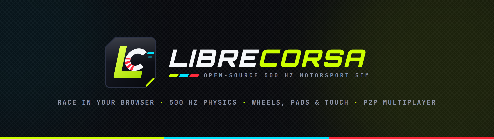
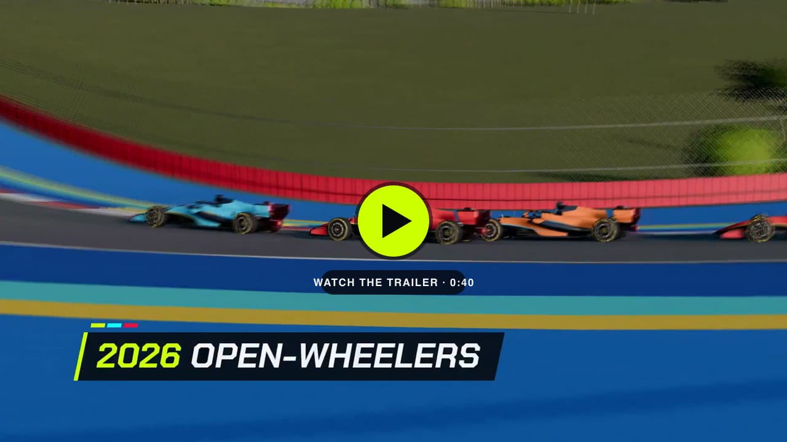
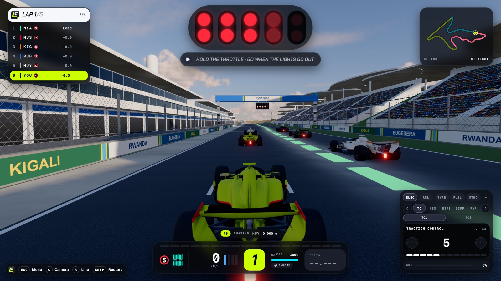
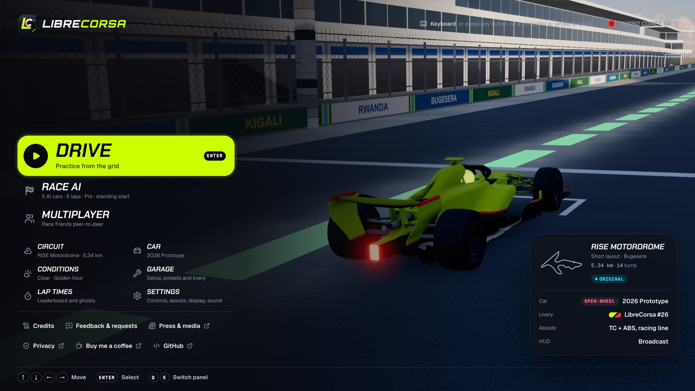
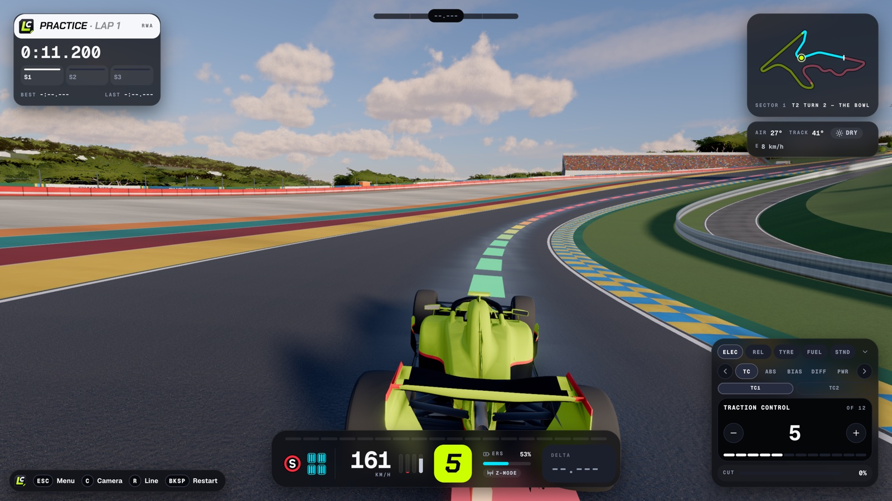
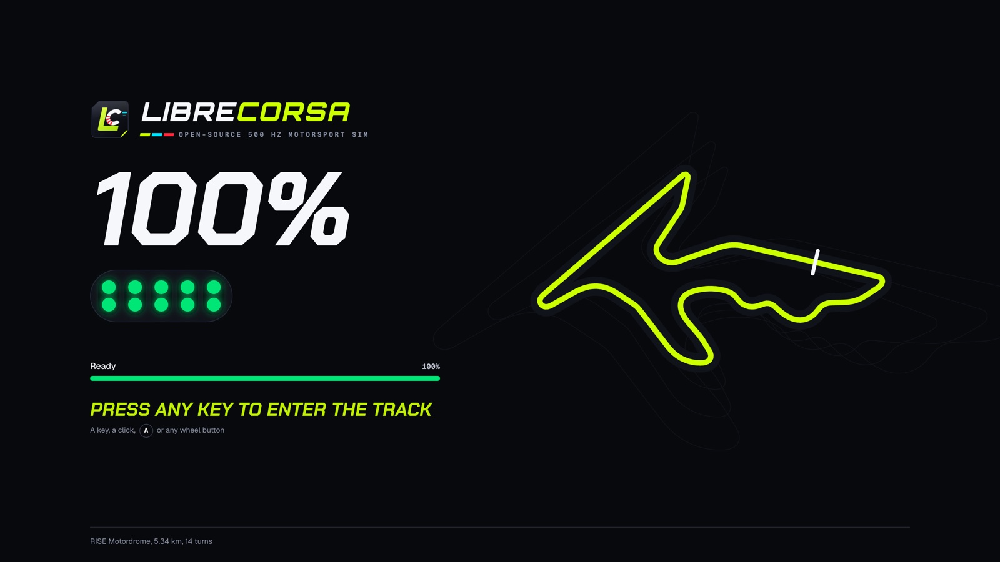

<div align="center">



<p>
  <a href="https://librecorsa.org/"><b>▶&nbsp; Play in your browser</b></a>
  &nbsp;·&nbsp;
  <a href="https://librecorsa.org/download">Download</a>
  &nbsp;·&nbsp;
  <a href="https://librecorsa.org/stats">Stats</a>
  &nbsp;·&nbsp;
  <a href="https://docs.librecorsa.org/">Docs</a>
  &nbsp;·&nbsp;
  <a href="https://docs.librecorsa.org/faq/">FAQ</a>
  &nbsp;·&nbsp;
  <a href="#features">Features</a>
  &nbsp;·&nbsp;
  <a href="#controls">Controls</a>
  &nbsp;·&nbsp;
  <a href="#development">Development</a>
  &nbsp;·&nbsp;
  <a href="CREDITS.md">Credits</a>
</p>

<p>
  <a href="https://github.com/librecorsa/librecorsa/actions/workflows/deploy-pages.yml"></a>
  <a href="LICENSE"></a>
  
  
  
  <a href="https://buymeacoffee.com/alpyalayg"></a>
</p>

</div>

<p align="center">
  <a href="https://librecorsa.org/media/librecorsa-trailer.mp4"></a>
</p>

**LibreCorsa** is an open-source racing simulator that runs entirely in the browser. It has 500 Hz vehicle dynamics, a thermal tyre model, 2026-, 2025- and 2007-regulation open-wheelers, two GT3 cars, two prototypes, six classic racing cars and two road cars. There are twenty circuits (35 layouts) and two hill climbs, career mode, time trials, AI races with pit stops, ghosts, lap telemetry and replays, peer-to-peer multiplayer, an open online race every 20 minutes, and 12 languages. It works with a keyboard, gamepad, touch screen or a force-feedback wheel, with optional triple-monitor and WebXR VR support. Nothing to install: the game is a static site, and an optional Cloudflare Worker runs the online side.

<p align="center">
  
</p>

<table>
  <tr>
    <td width="33%"></td>
    <td width="33%"></td>
    <td width="33%"></td>
  </tr>
  <tr>
    <td align="center"><sub>Title menu</sub></td>
    <td align="center"><sub>RISE Motordrome</sub></td>
    <td align="center"><sub>Every circuit draws itself while it loads</sub></td>
  </tr>
</table>

> LibreCorsa is an independent fan project. It is not affiliated with Formula 1, the FIA, any team or any circuit.

---

## Download apps

You can play straight in any modern browser at **[librecorsa.org](https://librecorsa.org/)**, or install an app from **[librecorsa.org/download](https://librecorsa.org/download)** / **[GitHub Releases](https://github.com/librecorsa/librecorsa/releases)**. The desktop app ([launcher/](launcher/README.md)) plays the live game when online and what it kept when offline, takes mods, converts circuits and cars from other games, and updates itself. The Android app opens the live site, so game updates arrive without reinstalling.

| Platform | Package | Notes |
| :-- | :-- | :-- |
| **Windows (x64)** | `LibreCorsa-*-win-x64.zip` | Unzip anywhere you can write to and run `LibreCorsa.exe`. Unsigned while SignPath setup finishes (*More info → Run anyway*) |
| **macOS** | `LibreCorsa-*-mac-arm64.dmg` / `mac-x64.dmg` | Apple Silicon and Intel. Drag `LibreCorsa.app` to Applications; not notarised yet, so the first time *System Settings > Privacy & Security > Open Anyway* |
| **Linux (x64)** | `LibreCorsa-*-linux-x64.tar.gz` | Unpack and run `librecorsa` in its folder, which adds LibreCorsa to the app menu |
| **Android (7+)** | `LibreCorsa-*-android.apk` | Signed fullscreen TWA (no browser bar, sticky-immersive, Game Mode, launcher shortcuts; Chrome required) |

---

## Features

### Physics
- **500 Hz fixed-step integration** (4 × 2 kHz sub-steps), with each wheel riding the real track surface. Every car runs on a 6-DOF rigid body that carries the spinning wheels' gyroscopic coupling. The tyres feel the road over the whole contact patch: five ground samples per wheel (centre, both ends, both tread edges) fold into one height and slope, so a seam or a kerb's step edge is rolled over rather than hit at a point, and the road carries a fine ISO 8608 texture (about 0.5 mm RMS) for them to roll over.
- **Tyres**: a Pacejka-style slip curve with combined slip on a friction ellipse, load sensitivity, carcass relaxation, a load-dependent rolling radius and a pneumatic trail set by the contact patch's length. The cornering stiffness saturates with load, so the peak slip angle grows under load. The contact patch is three strips (inner, middle, outer): camber and inflation move the load across them, and each grips by its own load and temperature, with a tread surface over the tread's bulk over the carcass liner in each. The brakes heat the rims, the rims and the carcass heat the inflation gas, and its pressure (less the carcass's stretch) sets carcass stiffness. The tyres wear. Soft, medium and hard slicks, plus intermediates and full wets that clear water up to a depth and aquaplane past it.
- **Chassis**: double-wishbone suspension built from its hardpoints, with springs, dampers, bump stops, anti-roll bars and heave elements. The solver poses each upright for camber, Ackermann and bump steer, and the tyre forces reach the body through the links: roll-centre jacking, anti-dive, anti-squat and anti-lift, and the full load transfer. The race cars have a preload / power / coast limited-slip differential, the R32 JTCC drives all four wheels through a centre coupling, the LC26 Prototype and the GT3s have compliant halfshafts, and every car has thermal brakes whose pad friction changes with temperature.
- **Steering**: the rack torque is the front tyres' moment about the kingpin axes: braking and drive force at the scrub radius, cornering force at the caster and pneumatic trail, the steered wheels' weight jacking, and the wheels' gyroscopic torque. A parked tyre twists against the road instead of turning freely, and the road texture reaches the rim only through the tyre forces. The LC26 Prototype and the GT3s have hydraulic power steering (the GT3's fades out with speed) and give up a little steering angle under cornering force.
- **Aero**: ride-height-sensitive wings and floor, altitude-corrected air density, and dirty air behind other cars. 2026 active aero switches between Z-mode (cornering) and X-mode (straights); the 2025 LC25 Prototype uses rear-wing DRS.
- **Surfaces**: one data table for road, kerb, sausage kerb, run-off, pit lane, grass and gravel, with dry and wet friction, rolling resistance, a bump ripple you feel through the wheel, vibration and whether it counts for track limits. A circuit can override it in its track data. Kerbs rise to a 32 mm crown with a 2 mm ripple.
- **Weather and time of day**: clear, overcast, light rain, heavy rain, drying and dynamic weather. The water film builds and drains in puddles and standing water, cars dry the racing line first, and rain beads on closed-cockpit windscreens (with working wipers) and kicks up lit tyre spray. Seven times of day, and the clock can run at up to 60×. On Medium and High graphics a physically based sky with volumetric clouds follows the weather, and wet asphalt reflects the trackside and lights.
- **Evolving track**: the racing line rubbers in as you drive.
- **Assists**: traction control on the friction circle, ABS, and a slip-angle-limited steering assist for keyboards and gamepads (S-curve key ramp, self-aligning, slide catch) with pedal slip help for the keys. Each can be tuned, and all but the keyboard's steering assist switched off.
- **Realism levels**: Casual (no tyre wear, forgiving tyre temperatures, milder rain), Standard and Full.

### Cars
| Car | Model | Notes |
| :-- | :-- | :-- |
| **LC26 Prototype** (default) | 6-DOF rigid body on the track colliders | 1.6 L V6 turbo + 350 kW MGU-K, 4 MJ battery, Boost (usable any time) and Overtake Mode (earned within 1 s at the detection point in races, +0.5 MJ recharge); turbo boost that builds with exhaust energy while the MGU-K fills the lag; Z/X-mode Straight Mode active aero; live telemetry channels |
| **LC25 Prototype** | 6-DOF rigid body | 2025-spec Formula car: 1.6 L V6 turbo + 120 kW MGU-K and an MGU-H, 4 MJ battery under the 2025 energy-flow rules, rear-wing DRS, ground-effect aero mapped against ride height |
| **F1 2007** | 6-DOF rigid body | 2007-spec Formula grid (11 teams, 26 driver liveries, each bringing its own team's chassis, V8 sound, animated steering driver and helmet, plus early-season Ferrari body): 2.4 L NA V8 to 19,000 rpm, 7-speed gearbox, grooved tyres, TC and no ABS, no ERS or DRS. Models, sounds and physics from Cimmerian Iter's mod, used with permission |
| **Mercedes-AMG GT3 Evo** | 6-DOF rigid body | 6.2 L NA V8, 6-speed sequential, multi-stage ABS / TC, its own braking-point model. The BMW M4 GT3 Evo drives on its physics |
| **MTRacing 496R** | 6-DOF rigid body | 2025 prototype: 4.0 L NA V8, rear-wheel drive, 6-speed paddle shift, heave springs, splitter / diffuser / rear-wing aero, TC, three slicks. 20 liveries, a live wheel screen and shift lights. Model, sound and physics from munyuturbo's mod of this car, used with permission |
| **LC-LMDH** | 6-DOF rigid body | LMDh prototype: twin-turbo V8 with the class's spec hybrid on a 7-speed spec gearbox, rear-wheel drive, power capped at the driveshafts as the regulations set it, TC and no ABS |
| **Nissan Skyline GT-R R33 JGTC** | 6-DOF rigid body | 1998 GT500: twin-turbo straight six, rear-wheel drive, 6-speed sequential, ride-height aero map. Model, sound and physics from gregsediting's mod of this car, used with permission |
| **Nissan Skyline GT-R R32 JTCC** | 6-DOF rigid body | 1993 Group A: twin-turbo straight six, four-wheel drive through a centre coupling. Model, sound and physics from gregsediting's mod of this car, used with permission |
| **Suzuki Liana 1.6** | 6-DOF rigid body | 2002 road car: 1.6 L four, front-wheel drive through an open differential, 5-speed manual, ABS and TC, one street tyre. Physics from alekabul's mod of this car, used with permission |
| **BMW M1 Procar** | 6-DOF rigid body | 1979 Procar: mid-mounted 3.5 L straight six, 5-speed manual, rear-wheel drive. Model, sound and physics from Pfalzdriver's mod of this car, used with permission |
| **Volkswagen Scirocco GTX 16V** | 6-DOF rigid body | 1985 road car: 1.8 L 16-valve four, front-wheel drive, 5-speed manual, one street tyre. Model, sound and physics from Pfalzdriver's mod of this car, used with permission |
| **Chaparral 2D** | 6-DOF rigid body | 1966 sports prototype: 5.4 L V8, two speeds on a torque converter, rear-wheel drive. Model, sound and physics from NPanic's mod of this car, used with permission |
| **Chaparral 2D 427** | 6-DOF rigid body | 1967: 7.0 L V8, three speeds on a torque converter, rear-wheel drive. From the same mod by NPanic, used with permission |
| **Porsche 934 Turbo RSR** | 6-DOF rigid body | 1976 Group 4: 3.0 L turbo flat six, 4-speed gearbox, rear-wheel drive, slicks or the original Group 4 tyres. Model, sound and physics from Pfalzdriver's mod of this car, used with permission |

Each car has its own cockpit, steering wheel and shift lights, plus a multi-layer sound bank (engine, turbo, transmission, shifts, backfires, limiter, tyre skid, TC cut). Interior and exterior sounds switch with the camera.

### Circuits
| Circuit | Country | Length |
| :-- | :-- | --: |
| **RISE Motordrome** (default; short / Grand Prix lap) | Rwanda | 5.34 / 5.89 km |
| Chang International Circuit | Thailand | 4.57 km |
| Okayama International Circuit (GP / Piper / Formula Drift) | Japan | 3.71 / 1.97 / 1.97 km |
| Red Bull Ring, Spielberg (GP / South / Inner skill course) | Austria | 4.31 / 2.34 / 0.93 km |
| Automotodrom Grobnik | Croatia | 4.17 km |
| Motorsport Arena Oschersleben | Germany | 3.69 km |
| Circuit de Monaco | Monaco | 3.31 km |
| Istanbul Park | Turkey | 5.32 km |
| Dunsfold Aerodrome | United Kingdom | 2.88 km |
| Barbagallo Raceway | Australia | 2.39 km |
| Virginia International Raceway (Full / North / South / Grand East / Grand West / Patriot, both ways) | United States | 5.25 / 3.66 / 2.61 / 6.46 / 6.64 / 1.57 km |
| Sachsenring (GP / short course) | Germany | 3.66 / 1.52 km |
| Norisring | Germany | 2.16 km |
| Circuit de la Sarthe, 1982 | France | 13.65 km |
| Bridgehampton Race Circuit | United States | 4.54 km |
| SpeedVegas | United States | 1.84 km |
| Riverside International Raceway (Long / Short / NASCAR course) | United States | 5.23 / 4.03 / 4.15 km |
| Watkins Glen International (Grand Prix / Short course) | United States | 5.46 / 3.93 km |
| Willow Springs International Raceway (Big Willow) | United States | 3.94 km |
| Qiddiya Speed Park | Saudi Arabia | 8.16 km |

### Hill climbs
| Hill climb | Country | Run | Climb |
| :-- | :-- | --: | --: |
| Goodwood (Festival of Speed) | United Kingdom | 1.89 km | 94 m |
| Borgloh (Osnabrück hill climb) | Germany | 2.02 km | 76 m |

RISE Motordrome is my reading of the circuit planned beside Lake Kidogo at Bugesera, about 1,400 m above sea level: traced on the designers' own aerial renders and built in Blender on the site's real ground by `scripts/tracks/rwanda-official/`. Two anticlockwise laps share one model: the short lap (5.34 km, 14 corners, the default) and the Grand Prix lap (5.89 km, 17 corners, 191 m climbed a lap). Chang, Okayama, Spielberg (Red Bull Ring), Grobnik, Oschersleben and Monaco are Assetto Corsa circuits by **Mitja Bonca** (used with permission), converted by `scripts/tracks/port_ac_track.py` with their 3D/2D trees, dynamic tyre grooves, skidmarks, starting lights and trackside semaphores, AI fast/pit lanes, kerbs, surface tables, section names, DRS zones, and TV cameras. Barbagallo and VIR are by **dazzyb2k3**, Sachsenring, Norisring, Le Mans 1982 and the two hill climbs by **gunnar333**, Watkins Glen, Bridgehampton and Riverside by **LilSki**, SpeedVegas by **Gogol**, Willow Springs by **Nukedrop**, and Istanbul Park by **Enver Bozkaya** (SRTR), all used with permission and converted the same way. Qiddiya Speed Park is by **Maxim555** (circuit) and **Zhenix** (scenery), both used with permission. Dunsfold Aerodrome is by **ACU**. A hill climb is one timed run from the start line to the finish, one car at a time, so it has no AI or online races. Every circuit is meshopt-compressed (`npm run compress-tracks`) while keeping hidden physics meshes bit-exact, and has a lap-time-optimal racing line for each car class (the hill climbs and Le Mans keep a geometric one for now). Open the sim with `?colliders=1` to see the physics surfaces drawn over the circuit.

### Racing
- **Career mode**: regional and historic ladders with seasons, rivals, promotions and pre-season test days, running from the Club Cup (Suzuki Liana) and Coupé Cup (VW Scirocco) through Touring, Classic GT, Prototype Cup, GT3, Endurance Prototypes and Grand Prix, plus Procar, Group 4 Classic and Can-Am Legends, with a TV-style pre-race show before each round.
- **Time trials**: a Weekly Trial on a rotating circuit and car (fixed assists and realism, dry track) alongside the permanent Middle Gear Lap Board (Suzuki Liana at Dunsfold), with Hall of Fame podium records and `S.T.I.G.` and `GOAT` badges.
- **Race the AI**: up to 11 AI cars (five by default, default skill 95) with optional qualifying, standing or rolling starts (with formation speed limiter, live pace bar and 3-2-1 countdown), pit stops using each circuit's real pit lane and boxes (with pit speed limiter and required stops), yellow and blue flags, Virtual Safety Car, traffic and side-by-side racing, and after the flag a cool-down lap, full-screen podium and results screen. The AI level runs from Rookie to Alien and can be changed from the pause menu. In the rain the AI fits intermediates or full wets and plans its corner speeds and braking on the wet grip. An optional voice spotter (off by default under **Settings → Audio**, three Kokoro-82M voices with an optional pit-radio filter) calls cars alongside.
- **Split gaps**: the gap to the car ahead and behind at every sector split.
- **Practice tools**: lap and sector timing, a live delta, a lap telemetry analysis view (speed, throttle, brake, gear and steering traces, driving line map and corner observations), a ghost of your best lap (saved locally, exportable and importable), flashback rewind, optional practice damage, an instant replay of up to 20 minutes with free cameras, and shareable car setups.
- **Multiplayer**: private rooms, peer-to-peer over WebRTC, with qualifying, full race rules, car class and spec locks, live livery sync, and car-to-car collisions on by default (with safety guards and a ghost toggle). Host a room and send the link, or join with a friend's 6-character code; a manual offer/answer copy-paste works with no server at all, and browser tabs on the same machine can race each other. On librecorsa.org the site's own room server pairs the players and hands out relay servers for networks that block a direct link; without it the public PeerJS broker pairs them. Other players' cars are sent 60 times a second and predicted to the present from their newest packet, timed by the fastest trip measured, so you touch a car where you see it; contact with them is soft and switches off while their packets are stale. A car that goes quiet keeps going for a second, turns see-through after half a second and disappears after two, until it is heard from again. Everyone in a room needs the same version of the game (and matching mod hashes when racing mods).
- **Open races**: under Multiplayer, a race on the week's circuit and car (RISE Motordrome in the Dunsfold week, which is a time trial only) starts every 20 minutes for whoever has joined, with the week's fastest on pole (alone, you race the AI). Cars are ghosts on the opening lap, and after it a car that is stopped, going the wrong way, rejoining the track or ramming another passes through the others, as does a car that has taken the flag.
- **Race results**: the race server (or a room's host) sends one official result for everyone. Open races are kept, and the Open races card shows the week's top five by wins and podiums and your own record. A result counts for your name once you've claimed it with a lap on the board.
- **Online leaderboard, profiles and accounts**: one board per circuit and car. Every driver appears once, with their fastest lap, car setup, assists, realism, surface and input icon (keyboard, controller, wheel or touch), and the board can be narrowed to no-assist, full-realism or wet laps. New personal bests are posted automatically, and any lap on the board can be raced as a ghost. Click any driver to open their profile and career totals. Optional accounts (Discord, Google, Steam or a passkey) keep your driver names, settings, setups, race history and best laps synced across devices; without an online side, the board lists your own best laps.
- **Usage counter and public stats**: when you stop driving, the game sends the circuit, the car, the mode, the minutes driven and the laps completed, and the site only adds them to daily totals by country (shown on the public [stats page](https://librecorsa.org/stats)). It also sends what you drove with, the kind of screen, whether the track was wet, the assists and the game's version, each counted on its own. No player id, no cookie, no address is kept, and nothing ties one drive to the next. What the site keeps is set out on the [privacy page](https://librecorsa.org/privacy).

The online side (rooms, boards, scheduled races) is a Cloudflare Worker in [`cloudflare/`](cloudflare/README.md). It is optional: a copy of the game without it still has peer-to-peer rooms and local lap times.
- **HUD and languages**: 15 HUD layouts (Blade by default) with a live layout editor (move, resize and toggle panels per layout) and colour-blind palettes, translated into 12 languages (English plus 11 translations, including right-to-left Arabic menus).
- **Cameras**: broadcast T-Cam (default), cockpit eye-point with live mirrors and the steering-wheel display, dash and shoulder views, chase presets, trackside TV cameras (`F8`) that pan, zoom and cut between corners, and a free-flying camera (`F7`).

### Hardware
- **Wheels**: steering, pedals and buttons through the browser for any wheel (including 8-way POV hat-switch D-pad navigation and automatic setup for bundles such as the MOZA R3). Force feedback straight from the browser over WebHID for bases that use the standard HID PID protocol, classic/HID++ Logitech wheels and listed Thrustmaster bases, or through a local bridge on Windows. See [Wheels and force feedback](#wheels-and-force-feedback) for what has been tested.
- **Gamepads**: Xbox and PlayStation, with rumble and trigger rumble. A DualSense paired over WebHID (Chrome or Edge) also gets adaptive triggers, haptics and its lights; DualSense and DualShock 4 support WebHID gyro tilt steering.
- **Touch**: on-screen pedals and steering (including a four-button layout), or tilt to steer. On a phone or tablet the title screen offers to install the game, so it opens full screen from the Home Screen.
- **Telemetry out**: 60 Hz UDP JSON through the bridge, for dashboards and motion rigs. The bridge relays it with or without a wheel, on Windows, macOS or Linux; the packet format is `TelemetryOutPacket` in `src/lib/input/telemetry-out.ts`.
- **Setup wizard**: picks your device, sets your driver profile, and tunes steering, pedals and force feedback on first launch.
- **Triple screens**: three independent off-axis views under **Settings → Display → Screens**, using your monitors' physical width, distance, bezel, side angle and eye height for true field of view, with menus and HUD on the centre screen and optional side-screen resolution scaling (not yet tested on a real triple-monitor rig).
- **VR (work in progress)**: WebXR headsets (standalone Meta Quest, Pico and Wolvic browsers, or Chrome with SteamVR / OpenXR), from the pause menu or **Settings → Display → Graphics**, with live wing mirrors, in-cockpit HUD plates, an in-headset pause panel and controller mapping. Standalone headset fixes were verified in an emulated Quest 3 and are not yet confirmed on real hardware.

### Wheels and force feedback

Steering, pedals and buttons come through the browser's Gamepad API, so any wheel that Windows, macOS or Linux sees as a game controller can drive. Force feedback has two paths:

- **In the browser (WebHID, Chrome or Edge)**: click **Connect wheel** under **Settings → Force feedback**. It drives bases that expose the standard USB HID PID force-feedback reports and the Logitech G25, G27, G29 and Driving Force GT with nothing to install, and the Logitech G920 and G923 for Xbox once Logitech G HUB has switched them out of Xbox mode. It also tries the Thrustmaster T300RS, T-GT II, T248, TX, TS-XW and TS-PC (untested), once a driver has switched the wheel out of its start-up mode. On a base that offers them, friction and inertia run on the wheel itself; the G27 and G29 get rev lights. Experimental.
- **Local bridge (Windows)**: a small helper that talks DirectInput to any force-feedback wheel. It needs a copy of this repository and Node.js: run `npm install` once, then `npm run ffb` and keep it open. The game finds it on `127.0.0.1:18500`. For the hosted site, allow its origin when you start the bridge (origin only, no path):
  - PowerShell: `$env:FFB_ALLOW_ORIGIN="https://librecorsa.org"; npm run ffb`
  - cmd: `set "FFB_ALLOW_ORIGIN=https://librecorsa.org" && npm run ffb`

Only what the maintainer has driven is marked tested. Everything else is what the code should do, not a promise:

| Wheel | Browser (WebHID) | Bridge (Windows) | Status |
| :-- | :-- | :-- | :-- |
| MOZA R9 V2 + KS | Works | Expected | **Tested: force feedback works** |
| Other MOZA bases, Simucube 2, VRS, OpenFFBoard, other HID PID bases | Expected | Expected | Untested |
| Simagic, Cammus, Asetek, Fanatec DD (PC mode), Thrustmaster DD | Unknown: without HID PID force feedback the page switches to the bridge | Expected | Untested |
| PXN V99 | Unknown: HID PID with Set Effect values of its own, which no PXN wheel has confirmed | Expected | Untested |
| Logitech G25, G27, G29, Driving Force GT | Expected: the classic Logitech commands, rev LEDs on the G27 and G29 | Expected | Untested |
| Logitech G920, G923 for Xbox | Expected: HID++ force feedback as Linux hid-logitech-hidpp sends it, in PC mode (G HUB switches it) | Expected | Untested |
| Logitech G923 for PlayStation, G PRO, Driving Force Pro | No: no mainline Linux driver to follow for the G923 for PlayStation or the G PRO, and the browser can't rescale the Driving Force Pro's steering axis | Expected | Untested |
| Thrustmaster T300RS, T-GT II, T248, TX, TS-XW, TS-PC | Unknown: the commands of the Linux driver hid-tmff2, once a driver has switched the wheel out of its start-up mode (Thrustmaster's on Windows, hid-tminit on Linux). If it has not, or Windows refuses the commands, the page switches to the bridge | Expected | Untested |
| Thrustmaster T150, TMX | Unknown: uses the browser's HID PID driver where Chrome or Edge exposes a PID collection, otherwise switches to the bridge | Expected | Untested |
| Thrustmaster T500RS | No: not covered by hid-tmff2 | Expected | Untested |
| Fanatec CSL Elite | Unknown: without HID PID force feedback the page switches to the bridge | Expected | Untested |

Drove one of these, or a wheel that isn't listed? A [wheel report](https://github.com/librecorsa/librecorsa/issues/new?template=wheel-report.yml) moves it into the table.

---

## Physics validation

The physics is checked against data, not just tuned by feel, and the evidence is generated from the simulator's own code so anyone can reproduce it ([full page](docs/physics/README.md), `npm run physics:report`).

- **The GT3 against a real car.** The Mercedes-AMG GT3 runs the same manoeuvres as reference GT3 Evo MoTeC logs: sustained cornering, braking and full-throttle g by speed, gearing and the understeer gradient. Every point sits within −13 % to +17 % of the logs, and `npm run verify` fails the build if one leaves its tolerance.
- **Tyre curves for the LC26 Prototype and the GT3**: force against slip angle at four loads, grip against load, temperature and pressure.
- **Honest gaps**: the LC26 Prototype corners 14 % below the cornering-limit table in its reference data at 86 km/h, where it runs out of front grip, and 4–17 % above it from 144 km/h up. The page says so.
- **Frame-rate independence**: physics runs in fixed 2 ms steps (500 Hz, four 2 kHz substeps), so the same three-second launch ends within 0.3 km/h and 0.2 m at 30, 60, 144 or 240 fps.

<p align="center">
  
  
</p>

---

## Controls

| Input | Action |
| :-- | :-- |
| `W` / `↑` · `S` / `↓` | Throttle · brake (ramped like a pedal) |
| `F` · `G` | Half throttle · half brake |
| `A` / `D` or `←` / `→` | Steer (speed-sensitive on keyboard) |
| `E` / `Q` · `N` | Upshift / downshift · neutral |
| `Space` / `Shift` / `B` | Boost (hold / latch); overrides ERS cuts any time |
| `Z` | 2026 Overtake Mode toggle (in races, once earned within `1 s`) |
| `X` | Active aero (Z-mode / X-mode) or DRS |
| `\` | Pit speed limiter |
| `U` · `Y` | Headlights toggle · flash |
| `C` | Cycle driving cameras |
| `F7` | Free camera (`WASD` fly · `Q`/`E` height · drag look · scroll speed · `R` reset) |
| `F8` | Trackside TV cameras |
| `T` | Instant replay |
| `O` · `I` / `Insert` | Multi-function display (MFD) toggle · cycle MFD page |
| `H` · `J` | Toggle HUD · toggle lap board |
| `R` | Racing and braking line |
| `P` | Racing-line autopilot |
| `V` | 1:1 mouse steering |
| `M` · `K` | Mute · skip music track |
| `Backspace` | Restart: from a flying lap outside a race, or the AI race from the start |
| `L` | Restart the lap from a flying start (outside a race) |
| `Esc` | Pause menu |
| **Gamepad** (GT style) | Left stick steer · `RT` / `R2` throttle · `LT` / `L2` brake · `A` / `✕` gear up · `X` / `□` gear down · `R3` boost · `L3` headlights (tap flash / hold toggle) · D-pad MFD |

Every binding can be changed under **Controls**.

---

## Development

```bash
npm install
npm run dev              # dev server at http://localhost:3000
npm run build            # static export into ./out
```

| Script | What it does |
| :-- | :-- |
| `npm run typecheck` | `tsc --noEmit` over the whole project |
| `npm run verify` | Every `scripts/verify/verify-*.ts` suite (physics, every car, input, lap tools, race session and race server, realism, weather, AI tuning, netcode, telemetry out, WebHID FFB and DualSense) |
| `npm run verify:laps` | Slow: player-style laps for every car and assist preset at full pace |
| `npm run physics:report` | Regenerate the [physics validation page](docs/physics/README.md): tyre curves, the GT3 against MoTeC logs, frame-rate checks |
| `npm run race:headless` | A full-physics AI race without rendering, faster than real time, with a results table. `-- --track rwanda_official --car amg-gt3 --weather heavy_rain --sweep skill` |
| `npm run compress-tracks` | Meshopt-compress the circuit GLBs and check the physics meshes are unchanged |
| `npm run ffb` | Local force-feedback (Windows) and telemetry bridge. Without a wheel, or with `-- --telemetry-only`, it relays telemetry only |
| `npm run upload-hosted -- <paths>` | Upload hosted-only cars or circuits to R2 (see [What's in the repository](#whats-in-the-repository)) |
| `npm run car-thumbs [-- <car id> ...]` | Render the car browser's picture of each car beside its files (`public/cars/<id>/thumb.webp`; upload a hosted car's with `upload-hosted`) |
| `npm run home-outlines` | Redraw the home page's circuit maps (`src/lib/home/circuit-outlines.json`) after adding a circuit or changing its line |
| `npm run mod -- check\|pack\|index` | Check a mod package as the game will, zip it for the game's importer, or list `public/mods/` for the dev server ([Making mods](docs/modding.md)) |
| `npm run launcher:build` | Build the offline launcher for macOS, Windows and Linux (`-- --bundle` adds the game beside each, [launcher/README.md](launcher/README.md)) |

The tech is **Next.js 16** (static export), **React 19**, **Three.js** (WebGL2, AgX tone mapping, PBR), the **Web Audio API**, **WebRTC**, **WebHID** and **Tailwind CSS 4**.

### What's in the repository
A clone carries **RISE Motordrome** and two cars, the **LC26 Prototype** and the **LC25 Prototype** (their bodies and sounds in `public/cars/f12026/` and `public/cars/lc25/`), so `npm run dev` gives you a working game with those. Every other car and circuit is hosted on librecorsa.org only and is gitignored: the files sit in the `librecorsa-assets` R2 bucket, and `cloudflare/worker.js` serves them at the same paths. A clone lists only what it has (`src/lib/hosted-content.ts`); the deploy sets `NEXT_PUBLIC_HOSTED_CONTENT=1` to list everything, and you can set it in `.env.local` if you have the hosted files in `public/`. The verify suites skip checks that need files a clone doesn't have.

To add your own car, see **[Porting a car](docs/PORTING-CARS.md)**, and for a circuit, **[Porting a circuit](docs/PORTING-TRACKS.md)**. To share one with players without changing the game, make it a mod package: **[Making mods](docs/modding.md)** (and **[Painting liveries](docs/LIVERIES.md)** for custom painted livery templates). Players use mods in the desktop app (the offline launcher): they drop a package into its mods folder or import it in its Mods panel. The game on librecorsa.org takes no mods. The same guides are on [docs.librecorsa.org](https://docs.librecorsa.org/), built from `docs/` by `docs-site/`. To publish a hosted car or circuit, upload its folder with `npm run upload-hosted -- public/cars/<id>` (car models go up compressed), then push to `main` so the edge cache picks it up.

### Offline play
After its first visit the game runs with no network: the service worker (`public/sw.js`) keeps the pages and scripts of the current build (listed by `npm run build` in `out/offline-manifest.json`), the circuits, cars and sounds already downloaded, and the mod packages imported. The **offline launcher** (`launcher/`, Go, no dependencies) serves a build and a mods folder on `127.0.0.1` and opens it in Chrome or Edge as an app window.

### Deployment
Every push to `main` runs typecheck and the verify suites, then builds `./out` and deploys it to Cloudflare at [librecorsa.org](https://librecorsa.org/) (`.github/workflows/deploy-pages.yml`, `wrangler.jsonc`). The old GitHub Pages address, `khazp.github.io/librecorsa/`, serves a redirect page that keeps old links working and carries a returning player's saved settings, setups and ghost laps over (`cloudflare/old-site-redirect.html`, `cloudflare/worker.js`). Cloudflare's asset store takes files up to 25 MiB, so CI moves anything bigger into the `librecorsa-assets` R2 bucket; the hosted-only cars and circuits live there too, and the Worker serves both at the same URL. The docs site at [docs.librecorsa.org](https://docs.librecorsa.org/) is a separate Worker (`docs-site/`), deployed by `.github/workflows/deploy-docs.yml` when a push changes `docs/` or `docs-site/`. Hosting runs on Cloudflare startup credits until March 2027.

---

## Code signing policy

Free code signing provided by [SignPath.io](https://about.signpath.io), certificate by [SignPath Foundation](https://signpath.org).

The desktop app's Windows program, `LibreCorsa.exe`, is built by GitHub Actions from this repository's source (`.github/workflows/release-launcher.yml`) when I push a `launcher-v*` tag, and it's published on the [Releases](https://github.com/librecorsa/librecorsa/releases) page. Signing through SignPath Foundation is being set up; until it's in place, `LibreCorsa.exe` is unsigned.

- **Committers and reviewers:** [KhazP](https://github.com/KhazP) (Alp Yalay). I review every pull request from anyone else before it's merged.
- **Approvers:** [KhazP](https://github.com/KhazP). I approve every signing request by hand.

**Privacy:** the desktop app plays the game from [librecorsa.org](https://librecorsa.org/play) and passes the game's online features on to it, so the site's [privacy policy](https://librecorsa.org/privacy) applies. Apart from that, the app only checks GitHub Releases for a newer version of itself and, the first time you convert a circuit or car and agree to it, downloads the converter's tools (uv, Node.js, Python and its packages) from their own sites.

## License & credits

- **Code** is under the [GNU Affero General Public License v3.0](LICENSE) or any later version (AGPL-3.0-or-later). You can use it, change it and host it, and if you run a changed version for other people, you share its source under the same licence. Code released before 15 November 2026 stays under the MIT License it came with.
- **3D models and audio** are for non-commercial, personal and educational use. Each one keeps its own license. This repository carries only RISE Motordrome and the LC26 and LC25 Prototypes' models and sounds; the rest are served on librecorsa.org for playing there.
- **Code contributors**: thank you to [**adamikoo**](https://github.com/adamikoo) for the Grand Prix HUD layout, the live HUD layout editor and start reaction timer, frame-loop scratches and Windows ARM GPU detection, live multiplayer livery sync, the voice spotter, lap telemetry analysis, Driver Profile 2.0 career totals, and HUD radar/panel visibility toggles ([#162](https://github.com/librecorsa/librecorsa/pull/162), [#182](https://github.com/librecorsa/librecorsa/pull/182), [#192](https://github.com/librecorsa/librecorsa/pull/192), [#193](https://github.com/librecorsa/librecorsa/pull/193), [#198](https://github.com/librecorsa/librecorsa/pull/198), [#200](https://github.com/librecorsa/librecorsa/pull/200), [#201](https://github.com/librecorsa/librecorsa/pull/201), [#202](https://github.com/librecorsa/librecorsa/pull/202)), [**dardalo-si**](https://github.com/dardalo-si) for the tyre gas law fix ([#17](https://github.com/librecorsa/librecorsa/pull/17)), [**hskl18**](https://github.com/hskl18) for Controls guide screenshots ([#205](https://github.com/librecorsa/librecorsa/pull/205)), and [**Ravi Giri**](https://github.com/Ravigiri2022) for the parallel verify runner ([#130](https://github.com/librecorsa/librecorsa/pull/130)).
- **Cars**: the LC26 Prototype's body is by **[Qvist Designs](https://qvistdesigns.framer.website/)** (CC BY 4.0), with the steering wheel from **DeX**'s AM26 model ([CC BY 4.0](https://skfb.ly/pKNCK)) and 2025 Pirelli tyres by **Purple Sector**, and the LC25 Prototype's body is by **shunqi** ([CC BY 4.0](https://sketchfab.com/3d-models/f1-2025-mclaren-mcl39-c6194270002b401bb25be7e35ab56e34)). The Mercedes-AMG GT3 Evo is by **Vecarz** ([CC BY-NC-SA 4.0](https://sketchfab.com/3d-models/mercedes-amg-gt3-wwwvecarzcom-6a3f7e3455064721b74b7f0b66427a07)), the BMW M4 GT3 Evo by **Ddiaz Design** ([CC BY-NC-SA 4.0](https://sketchfab.com/3d-models/2025-bmw-m4-gt3-evo-g82-113f83dd87064697a5ec2511d280b9d5)), and the LC-LMDH's body by **kilianhoffmann13** ([CC BY 4.0](https://sketchfab.com/models/d786aa263a804254aa92543dda11dba0)). The MTRacing 496R is by **[munyuturbo](https://www.patreon.com/cw/MTRacing651)**, the two Skyline GT-Rs by **[gregsediting](https://www.patreon.com/cw/gregsediting)**, the Suzuki Liana's physics by **alekabul**, the BMW M1 Procar, Volkswagen Scirocco and Porsche 934 by **Pfalzdriver**, the Chaparral 2Ds by **NPanic**, and the GT, prototype and classic racing tyre sidewalls by **sagatron918**, all used with permission.
- **Circuits**: Chang International Circuit, Okayama International Circuit, Spielberg (Red Bull Ring), Automotodrom Grobnik, Oschersleben and Circuit de Monaco are by **Mitja Bonca**, Barbagallo and VIR by **dazzyb2k3**, Sachsenring, Norisring, Le Mans 1982, Goodwood and Borgloh by **gunnar333**, Watkins Glen, Bridgehampton and Riverside by **LilSki**, SpeedVegas by **Gogol**, Willow Springs by **Nukedrop**, Istanbul Park by **Enver Bozkaya** (SRTR), and Qiddiya Speed Park by **Maxim555** (circuit) and **Zhenix** (scenery), all used with permission. Dunsfold Aerodrome is by **ACU**.
- **RISE Motordrome**: the circuit, its buildings, stands and props are the project's own, built by `scripts/tracks/rwanda-official/` and licensed under [CC BY-NC-SA 4.0](public/tracks/rwanda_official/LICENSE.md): port it or build on it with credit, non-commercially, under the same licence. Its trees are the acacia by **evolveduk** and the shrub by **Natural_Disbuster (lemedesign)**, both CC BY 4.0.
- **Rights holders**: if you made a model, texture, sound or other asset used here and want it credited, corrected or removed, open a [**rights / takedown request**](https://github.com/librecorsa/librecorsa/issues/new?template=takedown-request.yml). It will be fixed or removed from the live site, usually within 7 days.

> [!CAUTION]
> **No Official Cryptocurrency:** LibreCorsa has no official token or cryptocurrency, and is not related to any third-party actors trying to profit off of this repo. Any coin on crypto sites using the LibreCorsa name, logo, or repository link is unauthorized and unaffiliated with the developer.

Full attribution and links are in [CREDITS.md](CREDITS.md).
