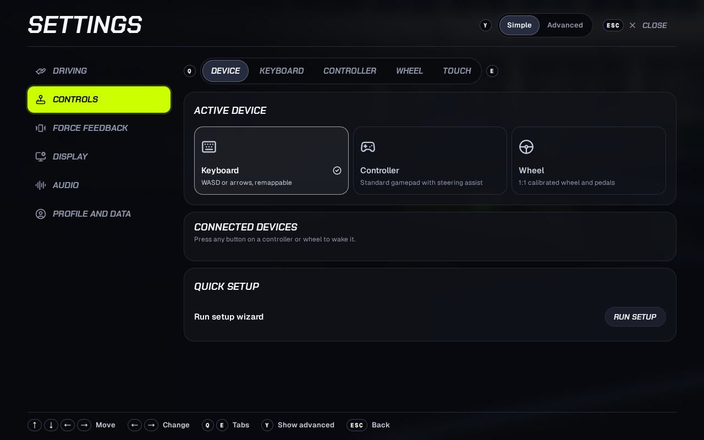
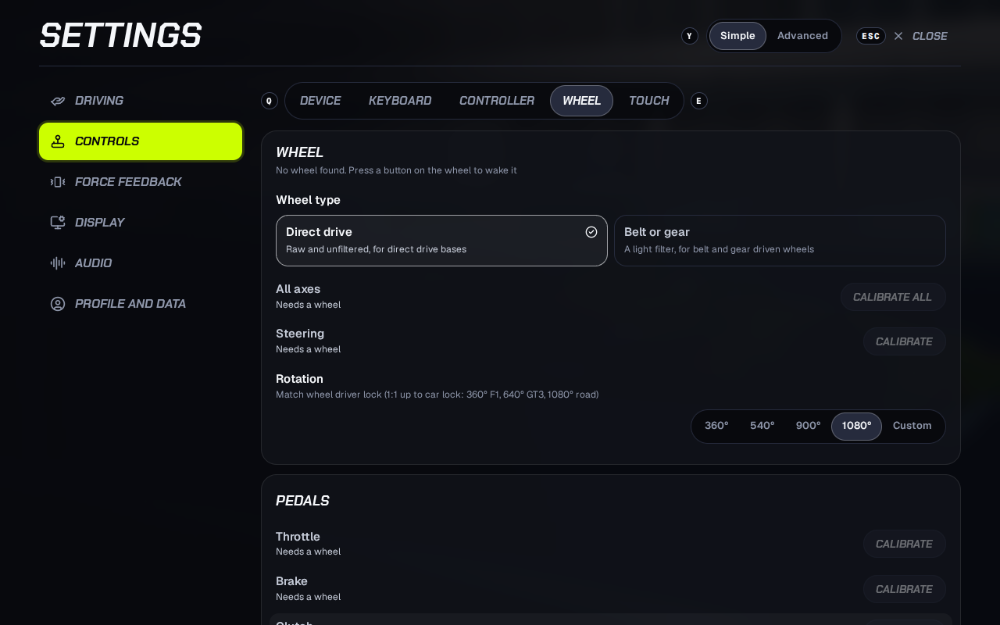

# Controls, controllers, and wheels

LibreCorsa supports keyboards, gamepads, touch screens, and racing wheels with pedals directly in the browser. All control settings are saved locally in the browser you play in.

## Navigating Settings

You can open **Settings** from the title menu or the pause menu (`Esc`, or `Menu` / `Options` on a controller).

- **Controls tabs:** Settings are grouped under **Controls** across five tabs: **Device**, **Keyboard**, **Controller**, **Wheel**, and **Touch**. Force feedback has its own top-level category (**Force feedback**), and driving assists live under **Driving**.
- **Active device:** Choose what you drive with under **Controls > Device**. Browsing another input tab won't switch your active device automatically.
- **Connected devices:** Lists every controller and wheel currently visible to the browser. If your hardware doesn't show up, press a button on it to wake it.
- **Run setup:** Found under **Controls > Device**; replays the first-launch wizard (device selection, calibration, assists, HUD layout, and starter car).
- **Simple vs. Advanced mode:** Toggle this switch at the top of Settings (`Y` on keyboard, `Y` / `△` on controller). Finer tuning controls marked **(Advanced)** below are hidden in Simple mode.
- **Resetting values:** Every settings card has a **Reset** button (with confirmation). To reset a single highlighted row, press `Delete` on keyboard or `X` / `□` on a controller.

## Keyboard

Default bindings are mapped by physical key position, so an AZERTY keyboard automatically displays `Z` where the table below lists `W`.

| Action | Default keys |
| :-- | :-- |
| Throttle, brake | `W` or `↑`, `S` or `↓` |
| Steer left, steer right | `A` or `←`, `D` or `→` |
| Gear up, gear down, neutral | `E`, `Q`, `N` |
| Boost (hold), boost (latch) | `Space` or either `Shift`, `B` |
| Overtake Mode (2026 race toggle) | `Z` |
| Active aero X / Z | `X` |
| Half throttle, half brake (hold) | `F`, `G` |
| Clutch (hold) | Unbound by default |
| Camera (hold: seat & camera), free camera, trackside TV camera | `C`, `F7`, `F8` |
| Racing line, autopilot, mouse steering | `R`, `P`, `V` |
| Restart, restart lap (flying start), instant replay | `Backspace`, `L`, `T` |
| Headlights on / off, flash headlights (hold) | `U`, `Y` |
| Pit speed limiter | `\` |
| Show / hide HUD, open / close lap board | `H`, `J` |
| Open / close MFD, next MFD page | `O`, `Insert` or `I` |
| MFD: pick a setting, change it (Electronics and Pit pages) | `,` `.`, `-` `=` |
| Mute, next music track | `M`, `K` |
| Pause menu | `Esc` |

### Customizing keyboard driving

- **Rebinding keys:** Open **Controls > Keyboard**, select a slot, and press the desired key. Most actions support two slots, and assigning a key already used elsewhere swaps the two bindings. Press `Esc` to cancel; key capture also times out automatically after 6 seconds.
- **Reserved keys:** `Esc` always opens the pause menu, and `/` opens the boost chat command. Neither can be rebound.
- **Pedal and steering feel:** Throttle and brake inputs ramp smoothly like pedals, while steering keys turn the front wheels up to the angle the front tyres can actually grip rather than snapping to full lock. In **Keyboard feel (Advanced)**, you can tune **Throttle rise**, **Brake rise**, **Steering smoothing**, **Steering return**, **Half throttle**, and **Half brake**.
- **Mouse steering:** Press `V` or toggle the switch in the **Mouse** card to steer using your horizontal cursor position on screen.
- **Fixed keys (Advanced):** Lists built-in shortcuts the game reserves for itself, such as `Alt` + arrow keys to adjust your cockpit seating position.

## Controller

Xbox and PlayStation controllers work out of the box through the browser's Gamepad API. The default preset is **GT style**:

| Action | Xbox | PlayStation |
| :-- | :-- | :-- |
| Steer | Left stick | Left stick |
| Throttle, brake | `RT`, `LT` | `R2`, `L2` |
| Gear up, gear down | `A`, `X` | `✕`, `□` |
| Boost | Right stick click | `R3` |
| Overtake Mode (2026 race) | None (`LB` in Formula style; Automatic Overtake on by default) | None (`L1` in Formula style) |
| Active aero | `Y` | `△` |
| Camera | `RB` | `R1` |
| Headlights (tap: flash, hold: on / off) | Left stick click | `L3` |
| Next MFD page, show / hide HUD | `B`, `LB` | `○`, `L1` |
| MFD: pick a setting, change it (Electronics and Pit pages) | D-pad left / right, up / down | D-pad left / right, up / down |
| Restart, pause menu | `View`, `Menu` | `Create`, `Options` |

Pressing gear up and gear down simultaneously shifts into neutral. All controller options live under **Controls > Controller**:

- **Feel and vibration:** Choose **Steering feel** (`Smooth`, `Default`, or `Sharp`), toggle **Vibration**, and check rumble with the **Test** button.
- **Input check:** Shows live steering, throttle, and brake telemetry as the game reads it.
- **Button layouts:** Choose from **GT style**, **GT classic**, **Formula style**, **Forza style**, or **Bumper shift**. Note that **GT classic** puts throttle and brake on the right stick and shifts gears with `RT` / `LT`.
- **Pedal mapping:** Choose **Triggers** or **Right stick** (push up for throttle, pull down for brake).
- **Custom button bindings:** Select any action slot and press a controller button to rebind it. Buttons currently assigned as pedals cannot be bound to other actions.
- **Fine tuning (Advanced):** Adjust **Steering speed**, **Inner dead zone**, **Outer dead zone**, **Stick linearity**, **Throttle curve**, **Brake curve**, **Pedal stick dead zone**, **Trigger rumble**, and **Trigger slip with ABS/TC on**. Trigger rumble requires pedals to be mapped to the triggers.
- **Controller steering assist:** Located under **Driving > Assists** (visible by default when your active device is **Controller**, otherwise shown in Advanced). Enabled by default, it caps steering lock to available front-tyre grip and helps catch slides. Fine-tune it under **Driving > Steering help (Advanced)**.

## DualSense and DualShock 4

In Chrome and Edge, LibreCorsa can communicate directly with PlayStation controllers over WebHID for hardware-native features. Other browsers still support standard rumble.

- **Pairing:** Plug in a DualSense and open **Controls > Controller** to reveal the DualSense card. Click **Connect DualSense** and select it in the browser prompt; future sessions reconnect automatically.
- **Adaptive triggers:** `L2` builds progressive resistance like a hydraulic brake pedal, while ABS pulses, lock-ups, and wheelspin vibrate through `L2` and `R2`. Choose **Soft**, **Medium**, or **Hard** trigger stiffness. Requires pedals to be mapped to the triggers.
- **HD haptics:** Plays kerbs, tyre slip, and engine harmonics through the controller's audio haptic actuators over USB only. The browser may request permission once to enumerate audio devices. When disabled, standard **Rumble strength** takes over.
- **Lightbar and rev lights:** Set the lightbar to display **Revs**, your **Driver colour**, or turn it off. The five player indicator LEDs fill across the bar as you approach the shift point.
- **Gyro steering:** Tilt the controller like a steering wheel while keeping the analog stick active alongside it. Supported on DualSense and on DualShock 4 (via **Connect DualShock 4** in the **Gyro steering** card). Configure **Tilt for full lock** (`10°`–`90°`) and **Sensitivity**. While driving, click the touchpad to re-centre gyro steering, or hold it to pause steering input.

## Touch screens

- **First-launch options:** On phones and tablets, the initial setup lets you choose between **Touch** (on-screen steering and pedals) and **Tilt** (tilt-to-steer with on-screen pedals).
- **Configuration:** Under **Controls > Touch**, configure **Touch controls** (`Auto`, `On`, or `Off`), **Touch style** (`Sliders` or `Buttons`), **Tilt to steer**, and **Tilt range** (`10°`–`60°`, default `30°`).
- **Tilt permission on iOS and iPadOS:** Safari prompts for motion access when you enable tilt steering. If you decline, steering automatically reverts to the on-screen slider.
- **On-track layout:** **Pause** and **Camera** buttons sit in the top-left corner, joined by **Recentre tilt** when tilt steering is active. **Shift up** and **Shift down** appear with a manual gearbox; with an automatic gearbox, a **Drive** / **Reverse** toggle appears when needed. **Boost**, **Overtake** (`OT`, in 2026 races), **Active aero**, and **Headlights** buttons appear only on cars equipped with them.

## Wheels and pedals

Steering axes, pedals, and wheel buttons are read via the browser's Gamepad API, meaning virtually any wheel recognized as a game controller by your OS can drive. When LibreCorsa detects a known wheel base by name, it automatically binds steering, selects the wheel type, and enables force feedback, though you should still run calibration.

All wheel settings live under **Controls > Wheel**:

- **Wheel type:** Choose **Direct drive** (raw, unfiltered signal; `1080°` default rotation) or **Belt or gear** (light smoothing filter; `900°` default rotation).
- **Calibrate all:** Walks through steering, throttle, and brake in order. For each step, hold the rim straight (or take your foot off the pedal) and click **Continue**, then turn the wheel roughly `90°` left or press the pedal all the way down and release. Inverted pedal axes are handled automatically. Press `Esc` (or `B` / `○` on a controller) to cancel.
- **Clutch pedal:** Optional and located in the **Pedals** card. Because **Calibrate all** skips it, use its dedicated **Calibrate** button (or **Remove** to unbind it).
- **Rotation:** Set to `360°`, `540°`, `900°`, `1080°`, or **Custom** (`180°`–`2520°`) to match your wheel driver's configured lock. The in-game steering wheel then tracks your physical rim 1:1 up to the real car's steering lock (`360°` for Formula cars, `640°` for GT3, `1080°` for the Suzuki Liana). With force feedback enabled, a soft lock pushes back past the car's physical limit.
- **Brake curve (Advanced):** Use `1.0` for load-cell pedals, or `1.3`–`1.6` for potentiometer pedals to give finer modulation near the top of pedal travel.
- **Steering filters (Advanced):** Override steering lock per car class if you prefer a quicker rack than the real car, and tune **Centre dead zone** and **Input filter**.
- **Wheel buttons:** Unbound by default. Select a slot and press a button on your rim. At minimum, bind gear paddles and a pause button; pulling both paddles together selects neutral.

> If you load onto the track with an uncalibrated throttle or brake axis on a wheel, a **Calibrate pedals** shortcut appears on the HUD outside of races and jumps directly to this tab.

## Clutch, gearbox, and assists

- **Clutch:** No input device binds a clutch by default, so the car operates its own clutch until you assign **Clutch (hold)** on keyboard, **Clutch** under **Controller > Buttons**, or a wheel clutch pedal.
- **Auto clutch:** Located under **Driving > Assists**. Can only be disabled when **Automatic gearbox** is off and your active device has a clutch bound. Touch controls do not support a manual clutch.
- **Neutral and reverse:** Gears run `R`, `N`, `1`, `2`… like a race car's sequential gearbox. Shifting down from first selects neutral, and down again selects reverse; shifting up from reverse goes back through neutral to first. First only drops into neutral, and reverse only engages, below roughly `7 km/h`, so mashing downshifts into a hairpin leaves you in first. To select neutral while moving, press **Neutral** (`N`) or both gear buttons together. The automatic gearbox works the same way; on touch, its **Drive** / **Reverse** button jumps straight to its gear.
- **Standing starts (Launch):** **Assisted** holds the car on the grid until lights out. **Manual** requires holding the clutch and balancing revs until the lights extinguish; moving early triggers a 5-second or 10-second jump-start penalty.
- **Assist presets:** Choose **Beginner** (full TC and ABS, racing line, steering assist), **Intermediate** (TC, ABS, and racing line), or **Sim** (all aids off). You can also configure **Traction control & ABS**, **Racing line**, and **Automatic gearbox** individually.
- **Keyboard pedal help:** **Throttle help** and **Brake help** gently modulate keyboard inputs during rear wheelspin and brake lock-ups when TC or ABS are turned off.

## Force feedback

Force feedback can be driven directly by the browser (experimental), in the desktop app, or via a local DirectInput bridge on Windows.

- **Browser (WebHID):** Requires Chrome or Edge over HTTPS (which `librecorsa.org` uses). Nothing to install.
- **Desktop app:** Opens the game in Chrome, Edge, Brave or Chromium, so it uses the same WebHID engine as the browser, device picker included. See [Verifying downloads](DOWNLOADS.md).
- **Local Windows bridge:** A lightweight helper that talks DirectInput to any FFB wheel on Windows. Clone the repository with Node.js installed, run `npm install` once, and keep `npm run ffb` running in the background. When playing on `librecorsa.org`, start it with `FFB_ALLOW_ORIGIN=https://librecorsa.org` (see [UDP telemetry and the local bridge](TELEMETRY.md) for all CLI flags and PowerShell / `cmd` examples, or the [README](../README.md#wheels-and-force-feedback)).

### Setting up WebHID force feedback

Open **Settings > Force feedback** and follow these steps:

1. Disable the desktop centring spring in your wheel base's own software.
2. Enable **Force feedback**.
3. Click **Connect wheel** and pick your wheel base in the browser prompt. After the first pairing, Chrome/Edge reconnects automatically on future visits. If force feedback is enabled and steering is bound without a paired wheel, the title and pause menus display a **Pair wheel for force feedback** banner with a quick **Connect** button.
4. Hold the rim firmly and click **Test** next to **Test direction**. The wheel should tug right, then left. If it pulls left first, enable **Invert**.
5. Adjust overall **Strength** (`0%`–`200%`).

### Additional force feedback settings

- **Effects (Advanced):** Configure **Damping**, **Kerb vibration**, **ABS vibration**, **Slip vibration**, and **Shift warning**. Slip vibration and shift warning are only available over the direct browser WebHID connection.
- **Fine tuning (Advanced):** Adjust **Force curve**, **Minimum force**, **Smoothing**, **Downforce compensation**, and **Collision protection**. Hardware **Friction** and **Inertia** sliders appear automatically if your wheel base supports running them on-device.
- **Per-car strength:** HUD layouts that include a Force feedback meter show **In range** or **Clipping** as you drive, and offer a one-click gain adjustment if a car consistently clips or feels too light. Saved per-car multipliers are listed in the **Forces** card, where **Clear** removes individual overrides.
- **Connection (Advanced):** Toggle **Browser connection** and configure **Rev lights** (supported on Logitech G27 and G29). Turning off **Browser connection**, or using a wheel the browser cannot drive, automatically falls back to the local Windows bridge.

## Supported wheels

Only the **MOZA R9 V2 with the KS rim** has been physically tested by the maintainer so far, where browser WebHID force feedback works end-to-end. Every other row reflects what the protocol implementation is built to support, not a verified guarantee.

| Wheel | Browser (WebHID) | Local bridge (Windows) |
| :-- | :-- | :-- |
| MOZA R9 V2 + KS | Tested | Expected |
| Other MOZA, Simucube 2, VRS, OpenFFBoard, and other HID PID bases | Expected | Expected |
| Simagic, Cammus, Asetek, Fanatec DD (PC mode), Thrustmaster DD | Unknown | Expected |
| PXN V99 | Unknown | Expected |
| Logitech G25, G27, Driving Force GT, G29 | Expected | Expected |
| Logitech G920, G923 for Xbox (in PC mode) | Expected | Expected |
| Logitech G923 for PlayStation, G PRO, Driving Force Pro | No | Expected |
| Thrustmaster T300RS, T-GT II, T248, TX, TS-XW, TS-PC | Unknown | Expected |
| Thrustmaster T150, TMX (HID PID, where Chrome on Windows shows it) | Unknown | Expected |
| Thrustmaster T500RS | No | Expected |
| Fanatec CSL Elite | Unknown | Expected |

- **Expected:** The driver implements the wheel's protocol, but hasn't yet been confirmed on physical hardware.
- **Unknown:** Behaviour depends on firmware/descriptor details and may fall back to the bridge.
- **No:** Browser WebHID cannot drive this wheel; use the Windows bridge instead.

For protocol details and how to add support for a new base, see [Porting wheels](PORTING-WHEELS.md).

## Troubleshooting

Switch **Settings** to **Advanced** mode first: once a wheel is connected, the **Connection** card, bridge status, and **Damping** controls are only visible there.

- **Wheel or controller isn't listed:** Press any button on the hardware to wake it, then re-open **Controls > Device**.
- **No steering or inverted/wrong pedal range:** Run **Calibrate all** under **Controls > Wheel**, making sure to depress each pedal completely to its stop.
- **No "Connect wheel" button:** Your browser doesn't support WebHID. In Advanced mode, **Browser connection** explains `"WebHID needs Chrome or Edge on https or localhost"`. Switch to Chrome or Edge, or use the Windows bridge.
- **Logitech G920 or G923 (Xbox) doesn't appear in the picker:** Switch the wheel into PC mode via Logitech G HUB first; the browser cannot see it in Xbox mode.
- **Thrustmaster wheel is rejected:** Thrustmaster bases boot in a start-up mode that requires a system driver (such as Thrustmaster's Windows driver) to switch them over before the browser can access them.
- **Wheel connects, but produces no force:** Verify that the centring spring is disabled in your wheel software, then click **Test**. Next, set **Damping** to `100%` and turn the rim by hand. If the wheel feels heavier, it is accepting condition effects and the issue is isolated to constant force, please file a report.
- **"Taken over" status on the bridge:** Another browser tab claimed the wheel. Close the other tab, or toggle **Force feedback** off and back on.
- **Submitting a wheel report:** Click **Copy diagnostics** in the **Connection** card and paste the output into a [wheel report issue](https://github.com/librecorsa/librecorsa/issues/new?template=wheel-report.yml). Confirmed reports help move wheels into the tested table.
