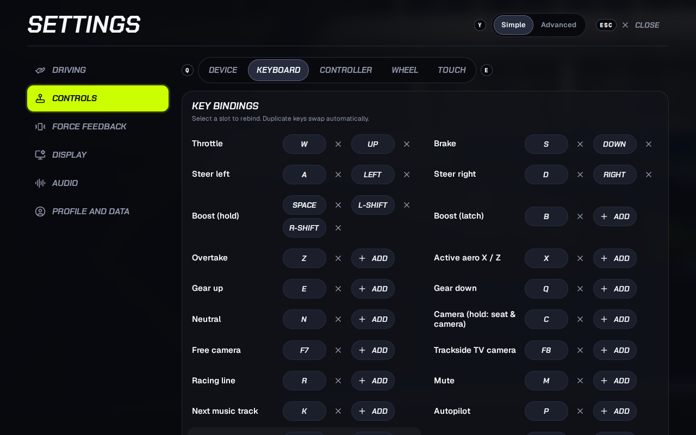
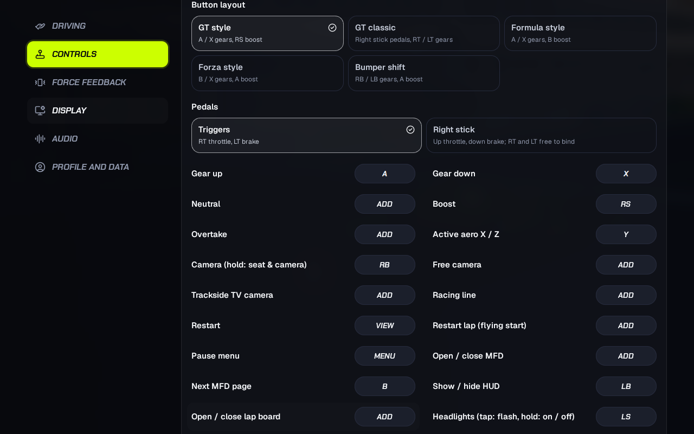
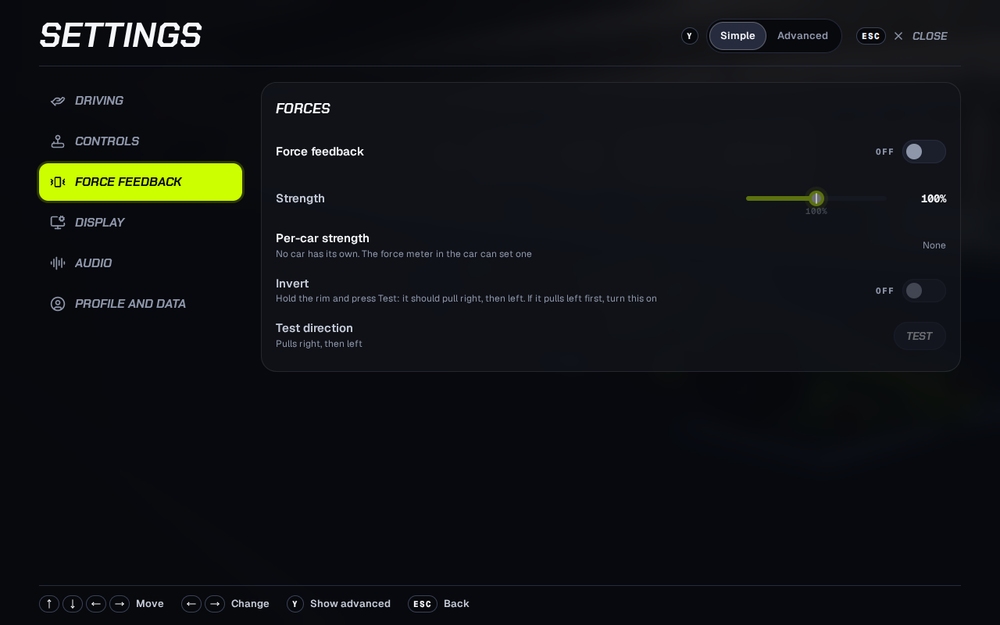

# Controls, controllers and wheels

LibreCorsa drives with a keyboard, a gamepad, a touch screen or a wheel with pedals. This page covers how to set each one up, where its settings are, and how force feedback works on a wheel. The game saves your settings in the browser you play in.

## Where the settings are

- **Settings**: on the title menu, and in the pause menu (Esc, or Menu / Options on a controller).
- **Controls**: five tabs: Device, Keyboard, Controller, Wheel and Touch. Force feedback has its own category, and the assists are under Driving.
- **Active device**: under Controls > Device. In Settings this is the only place that picks what you drive with, and looking at another tab doesn't change it.
- **Connected devices**: every controller and wheel the browser can see. If yours isn't listed, press a button on it to wake it.
- **Run setup**: under Controls > Device, runs the first-launch setup again (device, its setup, assists, HUD layout and car).
- **Simple / Advanced**: the switch at the top of Settings (Y on the keyboard, Y / △ on a controller). Many of the finer settings below only show in Advanced, and I mark those.
- **Reset**: every card has one, and it asks first. Delete, or X / □ on a controller, resets the row you're on.

## Keyboard

These are the default keys. They follow the key's position, so on an AZERTY keyboard the game shows Z where this table says W.

| Action | Keys |
| :-- | :-- |
| Throttle, brake | W or ↑, S or ↓ |
| Steer left, steer right | A or ←, D or → |
| Gear up, gear down, neutral | E, Q, N |
| Boost (hold), boost (latch) | Space or either Shift, B |
| Overtake Mode (2026 race toggle) | Z |
| Active aero X / Z | X |
| Half throttle, half brake (hold) | F, G |
| Clutch (hold) | none until you add one |
| Camera (hold: seat & camera), free camera, trackside TV camera | C, F7, F8 |
| Racing line, autopilot, mouse steering | R, P, V |
| Restart, restart lap (flying start), instant replay | Backspace, L, T |
| Headlights on / off, flash headlights (hold) | U, Y |
| Show / hide HUD, open / close lap board | H, J |
| Open / close MFD, next MFD page | O, Insert or I |
| Mute, next music track | M, K |
| Pause menu | Esc |

- **Key bindings**: under Controls > Keyboard. Select a slot, then press the new key. Most actions have two slots. Taking a key from another action swaps the two. Esc cancels, and the capture stops by itself after 6 seconds.
- **Keys you can't bind**: Esc always opens the pause menu, and / starts the boost chat command.
- **Feel**: throttle and brake ramp in like a pedal, and a steering key turns the wheels in to the angle the front tyres can hold, not to full lock. The Keyboard feel card (Advanced) sets Throttle rise, Brake rise, Steering smoothing, Steering return, Half throttle and Half brake.
- **Mouse steering**: V, or the switch in the Mouse card. The mouse's left-right position on the screen steers.
- **Fixed keys** (Advanced): lists the keys the game keeps for itself, such as Alt with the arrows to move the view in the cockpit.

## Controller

Xbox and PlayStation controllers work through the browser. The default layout is GT style:

| Action | Xbox | PlayStation |
| :-- | :-- | :-- |
| Steer | Left stick | Left stick |
| Throttle, brake | RT, LT | R2, L2 |
| Gear up, gear down | A, X | ✕, □ |
| Boost | Right stick click | R3 |
| Overtake Mode (2026 race) | none (LB in Formula style; Automatic Overtake on by default) | none (L1 in Formula style) |
| Active aero | Y | △ |
| Camera | RB | R1 |
| Headlights (tap: flash, hold: on / off) | Left stick click | L3 |
| Next MFD page, show / hide HUD | B, LB | ○, L1 |
| Restart, pause menu | View, Menu | Create, Options |

Gear up and gear down pressed together select neutral. Everything else is under Controls > Controller:

- **Feel and vibration**: Steering feel (Smooth, Default or Sharp), Vibration, and a Test button.
- **Input check**: the steering, throttle and brake as the game reads them.
- **Button layout**: GT style, GT classic, Formula style, Forza style or Bumper shift. GT classic drives on the right stick and shifts on RT / LT.
- **Pedals**: Triggers, or Right stick (up for throttle, down for brake).
- **One button**: press the action's slot, then the button. A button that is a pedal can't take an action.
- **Fine tuning** (Advanced): Steering speed, Inner dead zone, Outer dead zone, Stick linearity, Throttle curve, Brake curve, Pedal stick dead zone, Trigger rumble and Trigger slip with ABS/TC on. Trigger rumble needs the pedals on the triggers.
- **Controller steering assist**: under Driving > Assists (Advanced unless your device is Controller), on by default. It limits the lock to what the front tyres can take and catches slides. Driving > Steering help (Advanced) tunes it.

## DualSense and DualShock 4

In Chrome or Edge the game can talk to a PlayStation controller directly over WebHID. In other browsers standard rumble still works.

- **Pairing**: the DualSense card shows in Controls > Controller once one is plugged in. Press **Connect DualSense** and pick it in the browser's prompt. The browser remembers it after that.
- **Adaptive triggers**: L2 firms up like a brake pedal, and ABS, lock-ups and wheelspin buzz in L2 and R2. Trigger stiffness is Soft, Medium or Hard. They need the pedals on the triggers.
- **HD haptics**: kerbs, slip and the engine played as audio haptics, over a USB cable only. The browser may ask once to list audio devices. With them off, Rumble strength sets the rumble.
- **Lightbar and Rev lights**: the lightbar shows Revs, your Driver colour or nothing. The five player LEDs fill up to the shift point.
- **Gyro steering**: turn the controller like a steering wheel. The stick still steers too. It works with a DualSense, or a DualShock 4 connected with **Connect DualShock 4** in the Gyro steering card. Set Tilt for full lock (10° to 90°) and Sensitivity. Click the touchpad while driving to re-centre, and hold it to pause steering.

## Touch screens

- **First launch**: on a phone or tablet the setup offers Touch (on-screen steering and pedals) and Tilt (tilt to steer, on-screen pedals).
- **Controls > Touch**: Touch controls (Auto, On or Off), Touch style (Sliders or Buttons), Tilt to steer, and Tilt range (10° to 60°, 30° to start with).
- **Tilt on iPhone and iPad**: iOS asks before a page can read tilt, and the prompt comes when you turn tilt on. If you refuse, steering goes back to the on-screen slider.
- **On track**: Pause and Camera sit top left, with Recentre tilt while you tilt. Shift up and Shift down show with a manual gearbox. With the automatic one, a Drive or Reverse button shows when you need it. Boost, Overtake (OT, in 2026 races), Active aero and Headlights show when the car has them.

## Wheels and pedals

Steering, pedals and buttons come through the browser's Gamepad API, so any wheel your computer sees as a game controller can drive. When the game recognises a wheel base by its name, it binds the steering, picks the wheel type and switches force feedback on. Calibrate it anyway. Everything here is under Controls > Wheel:

- **Wheel type**: Direct drive (raw and unfiltered, 1080° rotation) or Belt or gear (a light filter, 900° rotation).
- **Calibrate all**: steering, then throttle, then brake. Each step asks you to hold the wheel straight, or take your foot off, and press Continue. Then turn the wheel about 90° to the left, or press the pedal all the way down and let it go. Inverted pedals work. Esc, or B / ○ on a controller, cancels.
- **Clutch**: optional, in the Pedals card. Calibrate all leaves it out, so press its own Calibrate. Remove unbinds it.
- **Rotation**: 360°, 540°, 900°, 1080° or Custom (180° to 2520°). Set it to the rotation in your wheel's own software. The car's steering wheel then turns 1:1 with your rim up to the car's real lock: 360° for the Formula cars, 640° for the GT3 and 1080° for the Suzuki Liana. With force feedback on, a soft lock pushes back past it.
- **Brake curve** (Advanced): 1.0 for a load cell, 1.3 to 1.6 for potentiometer pedals.
- **Steering filters** (Advanced): a steering lock per car class, for a quicker rack than the real car's, plus Centre dead zone and Input filter.
- **Buttons**: none are set to start with. Press a slot, then the button on the wheel. Gear paddles and a pause button are the essentials, and both paddles together select neutral.

If you drive with a wheel whose throttle or brake isn't calibrated, a **Calibrate pedals** button shows on the HUD outside a race. It opens this tab.

## Clutch, gearbox and assists

- **Clutch**: no device has one bound at first, and the car works its own clutch until you give it one: Clutch (hold) on the keyboard, Clutch in Controller > Buttons, or the clutch pedal on a wheel.
- **Auto clutch**: under Driving > Assists. You can switch it off only with Automatic gearbox off and a clutch bound on the device you drive with. Touch controls have no clutch.
- **Launch**: Assisted holds you on the grid until lights out. Manual means holding the clutch and revs and letting go at lights out, with a 5 or 10 second penalty for a jump start.
- **Assist level**: Beginner (full TC and ABS, racing line, steering assist), Intermediate (TC and ABS, racing line) or Sim (none of them). Traction control & ABS, Racing line and Automatic gearbox can also be set one by one.
- **Pedal help**: Throttle help and Brake help ease the keyboard pedals on rear slip and lock-ups, with TC or ABS off.

## Force feedback

Force feedback comes from the browser, the desktop app or a local bridge on Windows. From the browser it is experimental.

- **In the browser (WebHID)**: needs Chrome or Edge on https, which librecorsa.org is. Nothing to install.
- **The desktop app**: the same as the browser, but it grants DualSense controllers and racing wheels without the browser's device picker or permission prompt. See [Checking a download](DOWNLOADS.md).
- **The local bridge (Windows)**: a small helper that drives any DirectInput force-feedback wheel. It needs a copy of the repository and Node.js: run `npm install` once, then `npm run ffb`, and keep it open. For librecorsa.org, start it with `FFB_ALLOW_ORIGIN=https://librecorsa.org` set (the [README](../README.md#wheels-and-force-feedback) has the PowerShell and cmd lines).

To set it up in the browser, open Settings > Force feedback:

1. Turn off the centring spring in your wheel's own software.
2. Switch **Force feedback** on.
3. Press **Connect wheel** and pick the wheel in the browser's prompt. The browser asks once, then opens the wheel by itself on later visits. With force feedback on and the steering set up but no wheel paired, the title menu and the pause menu show **Pair wheel for force feedback** with a Connect button.
4. Hold the rim and press **Test** beside Test direction. It should pull right, then left. If it pulls left first, switch on **Invert**.
5. Set **Strength** (0 to 200 %).

The other cards:

- **Effects** (Advanced): Damping, Kerb vibration, ABS vibration, Slip vibration and Shift warning. The last two only play over the browser connection.
- **Fine tuning** (Advanced): Force curve, Minimum force, Smoothing, Downforce compensation and Collision protection. Friction and Inertia show when the wheel can run them itself.
- **Per-car strength**: while you drive, some HUD layouts show a Force feedback meter that reads Clipping or In range. When the force clips or stays light it offers to set a strength for that car. The Forces card lists those cars, and Clear removes one.
- **Connection** (Advanced): Browser connection, and Rev lights for the Logitech G27 and G29. With Browser connection off, or for a wheel the browser can't drive, the bridge takes over.

## Which wheels work

The MOZA R9 V2 with the KS rim is the only wheel I've driven, and its force feedback works in the browser. Everything else is what the code should do, not a promise.

| Wheel | Browser | Bridge |
| :-- | :-- | :-- |
| MOZA R9 V2 + KS | Tested | Expected |
| Other MOZA, Simucube 2, VRS, OpenFFBoard and other HID PID bases | Expected | Expected |
| Simagic, Cammus, Asetek, Fanatec DD (PC mode), Thrustmaster DD | Unknown | Expected |
| PXN V99 | Unknown | Expected |
| Logitech G25, G27, Driving Force GT, G29 | Expected | Expected |
| Logitech G920, G923 for Xbox (in PC mode) | Expected | Expected |
| Logitech G923 for PlayStation, G PRO, Driving Force Pro | No | Expected |
| Thrustmaster T300RS, T-GT II, T248, TX, TS-XW, TS-PC | Unknown | Expected |
| Thrustmaster T150, TMX, T500RS | No | Expected |
| Fanatec CSL Elite | Unknown | Expected |

Expected means the code fits the wheel but nobody has tried it, Unknown that it may not work, and No that the browser can't drive it. Where the browser can't, force feedback goes through the bridge. How the browser path works is in [Porting wheels](PORTING-WHEELS.md).

## When something doesn't work

Switch Settings to Advanced first. Once a wheel is connected, the Connection card, the bridge status and Damping only show there.

- **The wheel or controller isn't listed**: press a button on it, then look under Controls > Device again.
- **The car doesn't steer, or a pedal reads wrong**: run Calibrate all under Controls > Wheel, and press each pedal all the way down.
- **No Connect wheel button**: the browser has no WebHID, and in Advanced the Browser connection row says "WebHID needs Chrome or Edge on https or localhost". Switch to Chrome or Edge, use the desktop app, or use the bridge.
- **A Logitech G920 or G923 for Xbox isn't in the prompt**: switch it to PC mode in Logitech G HUB first. In Xbox mode the browser can't see it.
- **A Thrustmaster wheel is refused**: a driver has to switch it out of its start-up mode first (Thrustmaster's own on Windows), which the browser can't do.
- **Connected, but the rim doesn't move**: check the wheel's centring spring is off, and press Test. Then set Damping to 100 % and turn the rim by hand. If it feels heavier, the wheel takes effects and the problem is the steering force itself, so send a report.
- **Taken over** (bridge): another tab took the wheel. Close it, or switch force feedback off and on.
- **Reporting it**: press **Copy diagnostics** in the Connection card and add the text to a [wheel report](https://github.com/librecorsa/librecorsa/issues/new?template=wheel-report.yml). A report moves a wheel into the table.
